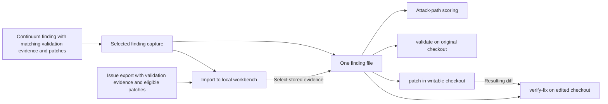

# Import AWS Continuum code issues and findings

Import Continuum issues to create one Codex Security record per issue ARN. The
issue provides exploitability and severity analysis, supporting details, and an
initial patch when available.

## Quick start

Open the matching checkout. Set `ENVIRONMENT_ID` to the Continuum environment ID. Verify which
repository supplied the scanned code, including the archive for an S3 source.
For a finding from another scanner, you can also check its repository in that
scanner. [AWS Continuum code sources](https://docs.aws.amazon.com/continuum/latest/userguide/cv-getting-started.html)

**Saved report.** Set `report` to a saved issue export, a finding capture with
validation evidence or patches, a native finding detail, an array of captures
or details, or a complete finding list. Then [preview the report](#preview-and-import).

```sh
report=/private/path/continuum.json
```

<a id="export-findings-for-one-repository"></a>
<a id="export-issues-for-one-repository"></a>

### Export issues from an environment

Install AWS CLI v2.38.5 or later outside the checkout. Sign in to the
environment's AWS account and Region. The export needs permissions for
`GetEnvironment`, `GetIntegration`, `ListCodeIssues`, `GetCodeIssue`,
`GetCodeFinding`, `ListCodeIssueArtifacts`, and `GetCodeIssueArtifact`.
[AWS Continuum permissions](https://docs.aws.amazon.com/service-authorization/latest/reference/list_continuum.html)

Pass the short Continuum environment ID to `codex-security import continuum`.
The command requires exactly one configured Git repository and records it as
`sourceRepositoryUrl`. S3 sources are allowed alongside that repository. An
environment with zero or multiple Git repositories fails before collection.
The command collects all issue pages, issue details, linked findings, and
`EVIDENCE` and `VALIDATION_EVIDENCE` attachments across the environment.
It also collects `PATCH` artifacts when Git is the only source. If the environment includes S3 sources,
use the [selected-finding collector](#collect-a-finding-with-patches) and the
exact AWS source name to capture patches for the Git repository. Before
publishing, verify that the issues belong to the recorded repository.

Use `--aws-profile PROFILE` to select AWS credentials, including a profile
that assumes a role in the environment's account. Use `--aws-region REGION`
to select the environment's Region. When omitted, the AWS CLI uses its usual
credential and Region settings. Keep AWS profiles, aliases, and custom models
outside the checkout. The CLI launches AWS from its installation directory
and filters the environment passed to AWS and its credential helpers.

```sh
report=
out=$(mktemp -d "${TMPDIR:-/tmp}/continuum.XXXXXX") &&
  codex-security import continuum "$ENVIRONMENT_ID" --format json > "$out/continuum.tmp" &&
  mv "$out/continuum.tmp" "$out/continuum-issues.json" &&
  report="$out/continuum-issues.json"
```

### Preview and import

Preview the report with a source key for this environment and repository.
The importer uses the repository URL saved in the issue export. For a saved
report without a repository URL, add
`--source-repository-url URL` with the verified Git URL.

```sh
codex-security publish findings "$report" --to local --repository . \
  --provider continuum \
  --source-key "continuum/$ENVIRONMENT_ID/example/project" \
  --dry-run --format json
```

Check the repository, source ARNs, paths, and exclusions. To save locally,
remove `--dry-run` and confirm.

<a id="publish-to-your-cloud-inbox"></a>

### Publish to Cloud

Preview the file and source key using your connected repository URL.

```sh
repo=https://github.com/example/project
codex-security publish findings "$report" --to cloud --repository "$repo" \
  --provider continuum \
  --source-key "continuum/$ENVIRONMENT_ID/example/project" \
  --dry-run --format json
```

Check the account, repository and source ARNs. The preview identifies the inbox
(`privateImport`) or repository environments (`requests`) that will receive them.
Remove `--dry-run` and confirm. Match the resulting source IDs to the Continuum
ARNs. A private inbox upload with changed evidence for the same ARN can return
`source_order_unknown`. [Verify the import](README.md#verify-the-import)

## Identity, evidence, and repeat imports

Issue imports use the issue ARN. The primary location can show its linked
finding's snippet and end line. When the issue summary is empty, the first
linked mitigation in issue order supplies remediation instructions. Validation
is stored alongside each contributing finding in `evidence.source_data.findings`.

The export keeps the AWS artifact responses in `issues[].issue.artifacts`.
The importer checks patch SHA-256 and byte count and stores matching patches
in `evidence.source_data.patches`. Each entry in `evidence.source_data.evidence_artifacts`
retains its artifact ID and type. `EVIDENCE` carries `body.prevalidationSignals`.
`VALIDATION_EVIDENCE` carries `body.validationEvidence`, including source
analysis, flow verdicts, or executed proof when supplied. If AWS returns the
validation artifact as `body.raw`, the importer preserves it in that form. The
observation's `details.scanner_verdict` uses the AWS exploitability verdict for
signals whose subject is the issue. Conflicting issue-level verdicts appear as
`MIXED`.

In Cloud, up to 100 locations are navigable. If the full linked evidence exceeds
the Cloud record size limit, publication tries to keep each linked finding's
verdict with the snippet and remediation. A record whose issue evidence still
exceeds the Cloud limit is reported as an exclusion. The original export retains
the complete linked findings and evidence attachments. Use the same source key
when repeating an issue import. Issue imports use `updatedAt` when available and
fall back to `statusUpdatedAt`. Previous imports keyed by finding ARN remain
separate records.

Finding summaries and details use the finding ARN. In the local workbench,
importing a detail response under the same source key updates the existing
summary. In a private Cloud inbox, retrying identical evidence under the same
source key preserves the finding.

Finding imports use `statusUpdatedAt` for the source update time when available.
Dependency findings expose affected package names and concrete versions.
Cloud can show up to 100 structured packages per finding. The full list,
including version ranges, remains in `evidence.source_data.finding` alongside
the AWS status and validation results. [AWS detail fields](https://docs.aws.amazon.com/continuum/latest/APIReference/API_GetCodeFinding.html)

## Import individual findings or legacy summaries

Use these AWS CLI exports when you want finding records identified by their
finding ARN. Pass the saved report to the same
[preview and publish commands](#preview-and-import) with the verified
`--source-repository-url URL`.

Use detail exports to keep locations, mitigation, and validation evidence.
A local summary import replaces richer evidence saved for the same finding
ARN and source key. In a multi-repository environment, the reader preserves
any repository prefix on a customer-supplied path.

**One finding.** Set `FINDING_ID` to the Continuum ID of the finding you
verified. In an environment with several repositories, use this command to
export one verified finding at a time. [AWS CLI get-code-finding](https://docs.aws.amazon.com/cli/latest/reference/continuum/get-code-finding.html)

```sh
report=
out=$(mktemp -d "${TMPDIR:-/tmp}/continuum.XXXXXX") &&
  aws continuum get-code-finding --environment-id "$ENVIRONMENT_ID" \
    --finding-id "$FINDING_ID" --output json > "$out/continuum.tmp" &&
  mv "$out/continuum.tmp" "$out/continuum.json" &&
  report="$out/continuum.json"
```

**Selected findings.** Fetch one detail response per finding ID. Verify each
belongs to the same environment and Git repository. To publish them together,
combine the saved objects into a JSON array with `jq`.

```sh
report=
out=$(mktemp -d "${TMPDIR:-/tmp}/continuum.XXXXXX") &&
  jq -s '.' first-detail.json second-detail.json > "$out/selected.json" &&
  report="$out/selected.json"
```

**All summaries.** Verify that the environment contains findings from just
this repository. Start on the first page and let the AWS CLI fetch every
page. [AWS CLI list-code-findings](https://docs.aws.amazon.com/cli/latest/reference/continuum/list-code-findings.html)

```sh
report=
out=$(mktemp -d "${TMPDIR:-/tmp}/continuum.XXXXXX") &&
  aws continuum list-code-findings --environment-id "$ENVIRONMENT_ID" \
    --output json > "$out/continuum.tmp" &&
  mv "$out/continuum.tmp" "$out/continuum.json" &&
  report="$out/continuum.json"
```

<a id="collect-a-finding-with-patches"></a>

### Collect one finding with validation evidence and patches

Pass the verified short finding ID to `import continuum --finding-id`. The CLI
uses your signed-in AWS CLI to read the finding, follow its created or duplicate
issue ID, and retrieve matching `VALIDATION_EVIDENCE` and `PATCH` artifacts.
This mode needs `continuum:GetCodeFinding`, `continuum:ListCodeIssueArtifacts`, and
`continuum:GetCodeIssueArtifact`. When validation has no per-finding breakdown,
the CLI uses `continuum:GetCodeIssue` to check which findings the issue covers.
[AWS issue artifacts](https://docs.aws.amazon.com/continuum/latest/APIReference/API_ListCodeIssueArtifacts.html)

Pass the absolute path of the local checkout that owns the finding as
`--source-root`, including when you run from another directory. The CLI applies
the same AWS launch checks and accepts the same `--aws-profile` and
`--aws-region` overrides as the bulk export.

Omit `--repository-name` when the environment contains exactly one Git
repository and no S3 sources. The CLI verifies this with
`continuum:GetEnvironment` before collecting the finding and can then include
patches that have no repository name.

For other environments, including S3-only environments, pass
`--repository-name "$AWS_SOURCE_NAME"` with the exact source name AWS assigns
to the repository. The collector keeps
patches with that exact name and prints the IDs of unnamed patches to stderr.
[AWS patch fields](https://docs.aws.amazon.com/continuum/latest/APIReference/API_PatchBody.html)

```sh
report=
source_root=/absolute/path/to/checkout
out=$(mktemp -d "${TMPDIR:-/tmp}/continuum.XXXXXX") &&
  codex-security import continuum "$ENVIRONMENT_ID" --finding-id "$FINDING_ID" \
    --source-root "$source_root" --repository-name "$AWS_SOURCE_NAME" \
    --format json > "$out/continuum.tmp" &&
  mv "$out/continuum.tmp" "$out/continuum.json" &&
  report="$out/continuum.json"
```

When AWS supplies `perFindingResults`, the capture retains the selected finding's
result, including its verdict and any flow or HTTP proof. Without that breakdown,
the collector can attach the whole validation artifact when the selected finding
is the issue's sole contributor. The capture records the issue ARN, issue ID,
and its `findingIds` in `validationIssue` so a saved import can verify that
association. Evidence shared by several findings without an identified subject
is omitted. If no artifacts match, the collector saves the
native finding detail. If an AWS read fails, retry the export before import.

Publish this report with `publish findings --provider continuum` and the verified
`--source-repository-url`. The record is identified by the finding ARN.

Attack-path scoring reads the imported validation artifacts from
`evidence.source_data.evidence_artifacts`. Matching patches are in
`evidence.source_data.patches`. Local imports keep the full validation and
patch bodies. Cloud keeps the validation bodies that fit, then uses the
remaining space for patches. Each omitted body's descriptor keeps the
artifact ID and records `contentOmitted: "cloud_evidence_limit"`. If the
validation descriptors themselves exceed the remaining space, Cloud publishes
the finding with its usual patch projection and omits the validation metadata.

## Use imported evidence in the matching checkout

Set `SOURCE_ARN` to the imported issue or finding ARN and `SOURCE_KEY` to the
key used at import. Select that record's evidence for the next step.

```sh
out=$(mktemp -d "${TMPDIR:-/tmp}/continuum.XXXXXX") &&
  codex-security findings imported . --format json > "$out/imported.json" &&
  jq -e --arg arn "$SOURCE_ARN" --arg key "$SOURCE_KEY" \
    '.findings[] | select(.provider == "continuum" and .sourceKey == $key and .sourceFindingId == $arn) | .evidence' \
    "$out/imported.json" > "$out/finding.json" &&
  finding="$out/finding.json"
```



<a id="score-an-imported-issue"></a>

### Score an imported issue or finding

From the matching checkout with the Codex Security plugin enabled, pass the
selected record to the standalone attack-path skill. It can use observations
in the AWS artifacts to establish or rule out reachability for the affected
flow.

```sh
codex exec --ephemeral -s read-only \
  "Use \$codex-security:attack-path-analysis to score the imported finding at $finding"
```

To rescore a matching finding in an existing Codex Security scan, use the
same evidence file as context for that finding.

```sh
codex-security classify-severity --scan "$SCAN_ID" --finding-id "$CODEX_FINDING_ID" \
  --knowledge-base "$finding"
```

### Patch and verify one finding

Use the selected evidence file or set `finding` to a single-finding collector capture.
`validate` assesses the original checkout. When an AWS patch is available,
`patch` starts from that diff and adapts it to the current code as needed.

```sh
codex-security validate "$finding"
codex-security patch "$finding"
```

Review the resulting diff and run the relevant regression tests. Use the same
finding file for an independent read-only check of the edited checkout.
`verify-fix` reports `fixed`, `still_vulnerable`, or `inconclusive` with evidence.

```sh
git diff
codex-security verify-fix "$finding"
```
