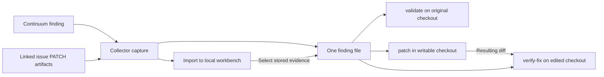

# Import AWS Continuum code findings

Collect a selected finding with its locations, mitigation, validation result
(when available), and any AWS-generated patches for its repository. The import
saves patches as evidence for review without applying them to your checkout.

## Quick start

Identify the matching local checkout. Set `ENVIRONMENT_ID` to the Continuum environment ID. Verify which
repository supplied the scanned code, including the archive for an S3 source.
For a finding from another scanner, you can also check its repository in that
scanner. [AWS Continuum code sources](https://docs.aws.amazon.com/continuum/latest/userguide/cv-getting-started.html)

**Saved report.** The importer can read a collector capture, a native
`GetCodeFinding` response, an array of either, or a complete `ListCodeFindings`
response from a single-repository environment. With a saved report, the importer
reads the file offline. Set its path and [preview the report](#preview-and-import).

```sh
report=/private/path/continuum.json
```

### Export findings for one repository

To create a report, sign in to the environment's AWS account and Region with
AWS CLI v2.38.5 or later, the first release with `aws continuum`. Choose one
export.

**One finding with available patches.** Set `FINDING_ID` to the verified
finding ID. The bundled Python 3.10+ collector uses your signed-in AWS CLI to read
the finding, follow its created or duplicate issue ID, and retrieve its
`PATCH` artifacts. Its IAM permissions are `continuum:GetCodeFinding`,
`continuum:ListCodeIssueArtifacts`, and `continuum:GetCodeIssueArtifact`.
[AWS issue artifacts](https://docs.aws.amazon.com/continuum/latest/APIReference/API_ListCodeIssueArtifacts.html)

Run the collector from a trusted shell outside the checkout. Set `source_root`
to the absolute path of the local checkout that owns the finding. The collector
uses your selected AWS profile and Region and omits shell, Python, and native
loader startup hooks when launching AWS and its credential helpers.
The example uses a global npm installation and a verified single-repository environment. For a multi-repository
environment, replace `--single-repository` with
`--repository-name "$AWS_SOURCE_NAME"`. Use the exact source name AWS assigns
to that repository. One issue can have patches for several sources. In this
mode the collector skips patches without a repository name and prints their
artifact IDs to stderr for review. [AWS patch fields](https://docs.aws.amazon.com/continuum/latest/APIReference/API_PatchBody.html)

```sh
report=
source_root=/absolute/path/to/checkout
plugin="$(npm root --global)/@openai/codex-security/_bundled_plugin"
out=$(mktemp -d "${TMPDIR:-/tmp}/continuum.XXXXXX") &&
  python3 -I "$plugin/skills/publish-findings/scripts/collect_continuum.py" \
    --environment-id "$ENVIRONMENT_ID" --finding-id "$FINDING_ID" \
    --source-root "$source_root" --single-repository > "$out/continuum.tmp" &&
  mv "$out/continuum.tmp" "$out/continuum.json" &&
  report="$out/continuum.json"
```

If the finding has no linked issue or no matching patches, the collector saves
the native finding detail. If an AWS read fails, retry the export before import.

**Selected findings.** Run the collector once per finding ID. Verify each
belongs to the same environment and Git repository. To publish them together,
combine the saved objects into a JSON array with `jq`.

```sh
report=
out=$(mktemp -d "${TMPDIR:-/tmp}/continuum.XXXXXX") &&
  jq -s '.' first-detail.json second-detail.json > "$out/selected.json" &&
  report="$out/selected.json"
```

**All summaries.** Verify that the environment contains findings from just
this repository. Start on the first page and let the AWS CLI fetch every
page. [AWS CLI list-code-findings](https://docs.aws.amazon.com/cli/latest/reference/continuum/list-code-findings.html)

```sh
report=
out=$(mktemp -d "${TMPDIR:-/tmp}/continuum.XXXXXX") &&
  aws continuum list-code-findings --environment-id "$ENVIRONMENT_ID" \
    --output json > "$out/continuum.tmp" &&
  mv "$out/continuum.tmp" "$out/continuum.json" &&
  report="$out/continuum.json"
```

### Preview and import

From the matching checkout, preview the saved report with the verified Git
URL and a source key for this environment and repository.

```sh
codex-security publish findings "$report" --to local --repository . \
  --provider continuum --source-repository-url https://github.com/example/project \
  --source-key "continuum/$ENVIRONMENT_ID/example/project" \
  --dry-run --format json
```

Check the repository, finding ARNs, paths, and exclusions. In a
multi-repository environment, a customer-supplied path can begin with a
repository name. The reader keeps that prefix. For local repeat imports, a summary replaces richer evidence already saved for the same ARN and source key. Use the collector capture to keep locations, mitigation, validation evidence, and available patches. To save locally, remove `--dry-run` and confirm.

Run `codex-security findings imported . --format json` and match the finding ARN.
The original AWS record is in `evidence.source_data.finding`. When AWS supplied
patches, `evidence.source_data.patches` contains one entry per matching
artifact with its ID (`artifactId`), exact patch text (`patch`), SHA-256
(`patchSha256`), byte count (`sizeBytes`), and AWS format and repository name
when supplied.

### Patch and verify one finding

From the checkout you want to fix, set `finding` to the path of a
single-finding collector capture. To use a local workbench record instead,
select its evidence by the finding ARN and the source key used at import.

```sh
out=$(mktemp -d "${TMPDIR:-/tmp}/continuum.XXXXXX") &&
  codex-security findings imported . --format json > "$out/imported.json" &&
  jq -e --arg arn "$FINDING_ARN" --arg key "$SOURCE_KEY" \
    '.findings[] | select(.provider == "continuum" and .sourceKey == $key and .sourceFindingId == $arn) | .evidence' \
    "$out/imported.json" > "$out/finding.json" &&
  finding="$out/finding.json"
```



`validate` assesses the original checkout. When an AWS patch is available,
`patch` starts from that diff and adapts it to the current code as needed.

```sh
codex-security validate "$finding"
codex-security patch "$finding"
```

Review the resulting diff and run the relevant regression tests. Use the same
finding file for an independent read-only check of the edited checkout.
`verify-fix` reports `fixed`, `still_vulnerable`, or `inconclusive` with evidence.

```sh
git diff
codex-security verify-fix "$finding"
```

<a id="publish-to-your-cloud-inbox"></a>

### Publish to Cloud

Publish the collector capture first to include available patches. Cloud uses
the same `evidence.source_data.patches` field. When patch text would exceed
the Cloud finding evidence limit, the patch entry retains its descriptors and
records `contentOmitted: "cloud_evidence_limit"`. If the finding and patch
metadata alone exceed the limit, the Cloud preview reports an exclusion. The
local capture retains the complete text. For private inbox imports, a later
upload with changed evidence for the same ARN can return `source_order_unknown`.
Preview the file and source key using your connected repository URL.

```sh
repo=https://github.com/example/project
codex-security publish findings "$report" --to cloud --repository "$repo" \
  --provider continuum --source-repository-url "$repo" \
  --source-key "continuum/$ENVIRONMENT_ID/example/project" \
  --dry-run --format json
```

Check the account, repository and finding ARNs. The preview identifies the inbox
(`privateImport`) or repository environments (`requests`) that will receive them.
Remove `--dry-run` and confirm. Match the resulting source IDs to the Continuum ARNs. [Verify the import](README.md#verify-the-import)

## Detail, summaries, and repeat imports

Both formats use the finding ARN. In the local workbench, importing a detail
response under the same source key updates the existing summary. In a private Cloud inbox,
retrying identical evidence under the same source key preserves the finding.

The importer uses `statusUpdatedAt` for the source update time when available.
Dependency findings expose affected package names and concrete versions.
Cloud can show up to 100 structured packages per finding. The full list,
including version ranges, remains in `evidence.source_data.finding` alongside
the AWS status and validation results. [AWS detail fields](https://docs.aws.amazon.com/continuum/latest/APIReference/API_GetCodeFinding.html)
