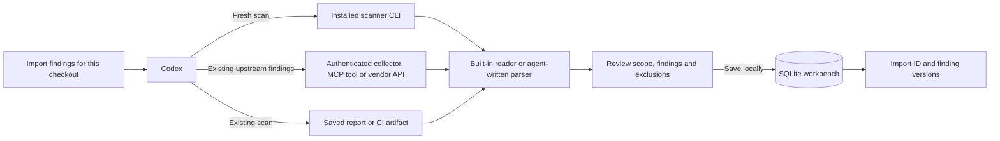
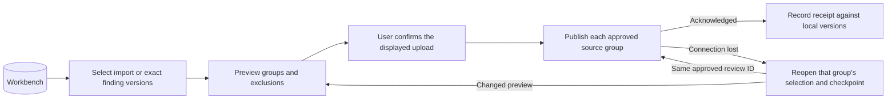

# Import with Codex and publish from the workbench

Open the target checkout in Codex with the Codex Security plugin enabled and its matching `@openai/codex-security` SDK available. Say what to collect, identify the repository or upstream project, and specify any ref or finding IDs that matter. Codex can choose a tool and write the findings to your local workbench from that one request. To inspect the results before saving, ask for a preview only. [Plugin setup](../agent-workflows.md#get-started)



## Run a scanner or import a saved result

> Run Trivy on this checkout and import its dependency findings.

Codex checks for the executable, runs the scanner in the selected directory, and imports its native report. These are the equivalent terminal commands from the checkout root. The last command previews the import. Remove `--dry-run` and confirm to save it.

```sh
reports=$(mktemp -d)
trivy fs --scanners vuln --format json --output "$reports/trivy.json" .
cs publish findings "$reports/trivy.json" --provider trivy --source-key acme/payments/fs \
  --repository . --trivy-scan-root . --to local --dry-run --format json
```

> Run Semgrep with `./rules.yml` and import the matches.

Codex can run `semgrep scan --config ./rules.yml --json-output "$reports/semgrep.json" .` and feed the export to the Semgrep reader. If you say “import the Semgrep report from yesterday’s CI run,” it reads that artifact. For OpenGrep, it uses the OpenGrep reader and includes scanner errors in the preview. [Semgrep formats](semgrep.md) · [OpenGrep formats](opengrep.md)

## Collect existing upstream findings

The following commands show what Codex can run for each built-in collector. You can also run them yourself. The Continuum, GitHub, Snyk and Semgrep commands return reports on stdout. Codex can save the report privately and import it with the matching reader and a stable source key. Sonar returns a replayable capture and can write directly to the workbench.

| What you ask Codex                                                                       | Collector and what happens                                                                                                                                                                                                                                                                              |
| ---------------------------------------------------------------------------------------- | ------------------------------------------------------------------------------------------------------------------------------------------------------------------------------------------------------------------------------------------------------------------------------------------------------- |
| “Import Continuum issues from environment E for this checkout.”                          | `cs import continuum E --format json` requires exactly one Git repository and records it in the report. S3 sources may also be present. Verify scope with `cs publish findings --dry-run`. [Continuum](continuum.md)                                                                                    |
| “Import GitHub code-scanning alert 17 from acme/payments.”                               | `cs import github acme/payments --github-alert 17 --format json` uses the signed-in `gh` CLI to fetch the alert and its instance.                                                                                                                                                                       |
| “Import published repository advisories for acme/payments.”                              | `cs import github-advisories acme/payments --format json` uses `gh` to fetch published advisories. For a global advisory, give its exact GHSA ID and use `--github-advisory-source global --github-advisory ID`.                                                                                        |
| “Import monitored Snyk Code issues for project P in organization O into this checkout.”  | `cs import snyk P --org O --snyk-product code --source-repository-url https://github.com/acme/payments --format json` uses `SNYK_TOKEN` to page through the Snyk API.                                                                                                                                   |
| “Import the Semgrep Platform SAST backlog for acme/payments on main in deployment acme.” | `cs import semgrep acme/payments --deployment acme --ref refs/heads/main --format json` uses the Web API with `SEMGREP_APP_TOKEN` to collect the project and ref.                                                                                                                                       |
| “Import Sonar issue ISSUE_A from project payments on main.”                              | `cs import sonar --sonar-project payments --sonar-branch main --sonar-issue ISSUE_A --dry-run --format json` uses the active `sonar` login. Codex reads the returned capture path and can save it with `cs import sonar "$capture" --yes`. [Sonar capture and Cloud replay](sonar.md#import-and-verify) |

> Import Guardian SAST findings `101` and `103` for acme/payments on `refs/heads/main` in deployment acme.

Codex inspects the connected tools and calls `get_semgrep_sast_findings` with the requested scope, retaining the selected rows and their exact string IDs. For Guardian Supply Chain it calls `get_semgrep_supply_chain_findings`. For the separate hosted Semgrep Platform MCP, it verifies the project’s SCM URL and uses `IssuesService_ListIssues` with the project, ref and SAST IDs. A missing connection or ID is reported. The two services have separate ID namespaces. [Guardian and hosted MCP examples](semgrep.md)

**Check a hosted collection.** For GitHub, match the requested alert number and ref, or the advisory’s GHSA ID and publication state. For a Snyk or Semgrep backlog, use a two-page fixture and verify that both pages belong to the selected project. Replay the Sonar capture after disconnecting the vendor CLI and compare issue keys. For MCP, return two neighboring string IDs, request one, and verify the tool arguments and the single stored ID.

## Other scanner inputs

For a saved export, say which checkout and report to use. For an upstream read, identify the account, repository and selection. These requests use the same local preview and import. [All readers and supported report formats](README.md#choose-your-scanner)

| What you say                                                             | What Codex calls or reads                                                                                                         | What to check in QA                                                                                                                   |
| ------------------------------------------------------------------------ | --------------------------------------------------------------------------------------------------------------------------------- | ------------------------------------------------------------------------------------------------------------------------------------- |
| “Import Dependabot alerts for acme/payments.”                            | Pages through `GET /repos/acme/payments/dependabot/alerts` via the GitHub connection or an authorized REST client.                | Two alerts sharing one advisory retain distinct alert numbers. [Dependabot](github-dependabot.md)                                     |
| “Run OpenGrep with rules.yml and import the results.”                    | Runs `opengrep scan` with JSON output and uses the `opengrep` reader.                                                             | A parse error alongside a match remains in `report.errors`; the match records OpenGrep as its scanner. [OpenGrep](opengrep.md)        |
| “Scan package.json for Snyk dependency issues.”                          | Runs the signed-in `snyk test --file=package.json` with JSON file output and imports the native dependency report.                | A findings exit code of 1 still produces findings with the reported dependency paths. [Snyk CLI](snyk.md#native-cli-json)             |
| “Import Wiz package occurrences A and B for this repo.”                  | Fetches those occurrences through the connected Wiz tool or reads a detailed package vulnerability export.                        | Compare the stored Wiz occurrence IDs with A and B, including when both share a CVE. [Wiz](wiz.md)                                    |
| “Get Inspector findings for this Code Security repository in us-east-1.” | Runs `aws inspector2 list-findings` for the account and exact `CODE_REPOSITORY` resource.                                         | A fixture containing EC2 findings imports only the eligible repository findings, identified by finding ARN. [Inspector](inspector.md) |
| “Import Continuum finding F from environment E.”                         | Collects the detailed finding and linked PATCH artifacts for the verified repository.                                             | Match the stored ARN and any `source_data.patches` to the AWS finding and issue artifacts. [Continuum](continuum.md#collect-a-finding-with-patches)                  |
| “Import this Black Duck project version’s vulnerable components.”        | Reads the complete BOM-6 collection for that version and verifies the Git repository.                                             | The stored `source_data.projectVersionUrl` identifies the selected version. [Black Duck](blackduck.md)                                |
| “Import completed Checkmarx scan S for payments.”                        | Exports Checkmarx One JSON with `cx results show`, or reads the self-managed CxSAST scan’s XML.                                   | The retained scan ID is S and the result’s ordered path nodes match the export. [Checkmarx](checkmarx.md)                             |
| “Get Endor Findings A and B from this project and namespace.”            | Filters `endorctl api list --resource Finding` to the project, scan context and requested UUIDs.                                  | The preview contains both requested finding UUIDs once. [Endor Labs](endor.md)                                                        |
| “Import Veracode STATIC policy flaws for application A.”                 | Reads the application’s Findings API pages for `scan_type=STATIC`, retaining pagination and application links.                    | A flaw on the last page retains its native `issue_id` and application URL. [Veracode](veracode.md)                                    |
| “Import Tenable findings A and B from this Code Repository asset.”       | Uses the Inventory export or existing CSVs, selects the asset and finding UUIDs, and checks the Git remote before saving locally. | Only A and B belong to the import. Cloud preview identifies Tenable as local-only. [Tenable One](tenable.md)                          |

For the fresh-scan examples above, check the manifest path and installed version for Trivy and the rule ID and source line for Semgrep. For a CI artifact, edit the affected source file after the scan and check that the preview retains the line recorded in the report.

## Import an unfamiliar format

> Import this AcmeScanner JSON for acme/payments. Use its occurrence keys and show me any rows you skip.

For an unfamiliar format, Codex inspects sample records and writes a parser. It emits `{ read, findings, excluded }` with a stable string `source_finding_id` and evidence for each finding. It passes the result to `prepareNormalizedLocalImport(data, { provider, sourceKey, repository, sourceRepositoryUrl })`, inspects `.preview`, then calls `.import()` for the requested write. A nonempty import records its membership, including findings already stored at the same version. Tenable and custom provider names can be used locally. [SDK import contract](../../sdk/typescript/docs/sdk.md#import-external-findings)

## Publish in a later session

> Publish the high-severity findings from my Trivy and Semgrep imports for acme/payments to its connected Cloud repository.

Codex uses the import history and the requested severity to select stored finding IDs and versions. You can also give it an import ID to select the whole batch. The vendor login and original report are no longer needed. Codex calls `prepareStoredFindingsPublication(selection, { repository: cloudRepository })` and shows the destination, source groups, evidence and exclusions. A group is one provider and source key. Cloud eligibility depends on the provider, selected evidence and destination.



You can confirm the displayed groups together. Codex retains each approved group’s `.selection` and `.reviewId` and calls `group.publish(savedReviewId)`. If a later group is interrupted, it reopens that group and resumes the existing submission. Completed groups keep their receipts. A changed selection or destination requires reviewing the new preview.

To preview an existing report for upload from the terminal, run `cs publish findings FILE --provider PROVIDER --source-key KEY --repository CLOUD_REPO --to cloud --dry-run` with the report's scanner options. Remove `--dry-run` and confirm to publish. For a Codex Security CSV or JSON export of a completed scan, `cs scan import FILE` saves it in scan history. [CLI input choices](README.md#choose-your-input)

## Test each part

Run these from the repository root after installing the pinned SDK/plugin dependencies and building the SDK and bundled plugin. Use a disposable checkout and private state directory. The publication tests start a local HTTP server and use real SQLite. [Test setup and native payload](../../sdk/typescript/TESTING.md#install-dependencies)

**Local import and selection.** Import the same evidence twice. Expect two import IDs and the same finding version. Change the evidence, then try the first import ID. The SDK should ask for a new selection. Also try a different checkout and a parser row with a missing occurrence ID or a conflicting repository.

```sh
(cd plugins/codex-security/mcp-app && node --experimental-strip-types --test tests/test_external_findings.ts tests/test_workbench_findings.ts)
(cd sdk/typescript && bun test --timeout 60000 tests-ts/local-finding-report.test.ts tests-ts/semgrep-platform-collector.test.ts tests-ts/semgrep-guardian-findings.test.ts)
```

**Publish and resume.** Import Trivy and Guardian, delete the files, and preview a subset across both sources. Drop the response after the server accepts the second source. Resume using that group's original approval. Check that the first group was sent once, the second receives its receipt, and the unselected row has none. Change the destination or remote version and check that the old approval is rejected before any upload.

For each Cloud-supported reader, preview a native file with `prepareExternalPublication`, then import the same file locally. Delete the file and preview the import ID with `prepareStoredFindingsPublication` using the same Cloud repository and source key. Compare the destination, occurrence IDs, evidence, report metadata and exclusions. Publish to a disposable destination and verify a receipt for each accepted local version. For Tenable and a custom provider, check the exclusion reason and zero uploads.

```sh
(cd sdk/typescript && bun test --timeout 60000 tests-ts/external-findings-publish.test.ts tests-ts/stored-finding-projection.test.ts tests-ts/stored-native-private-report.test.ts tests-ts/sonar-import.test.ts)
```

**Codex and CLI.** Run the two-source example and inspect `cs import --help`. In a plugin-enabled session, ask for one finding ID from an MCP response containing two. Verify the actual tool call, repository and ref, then inspect import membership in a fresh process. For a fresh scanner, check the executable invocation. For an unfamiliar format, check the parser's occurrence IDs and exclusions. The routing tests exercise skill discovery. These acquisition checks exercise what the agent does after discovery. [Runnable example](../../examples/normalized-import/README.md) · [Model routing evaluation](../../evals/workflow-routing/README.md)

```sh
node --experimental-strip-types --test evals/workflow-routing/test_*.mts
(cd sdk/typescript && bun test --timeout 60000 tests-ts/cli-help.test.ts tests-ts/cli-external-imports.test.ts tests-ts/cli-local-import.test.ts)
```
