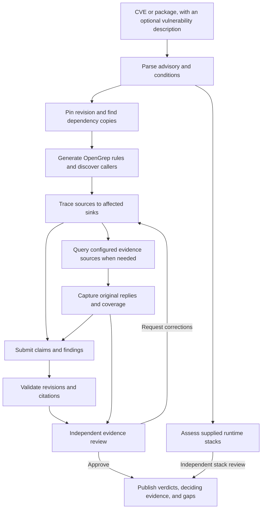

# Check dependency exploitability

Investigate whether a vulnerability in a dependency can affect your application. Run a check against a CVE or a package, follow the affected operation through your code, and get a reviewed report with the evidence and any questions that remain.

`cs exploitability check` inspects the repository at a Git revision. You can narrow the investigation with source and sink functions, include captured runtime stacks, and connect an inventory or telemetry service to establish which build is running and who can reach it.

## Before you begin

Install the [Codex Security CLI](../README.md#install). Open a Git checkout with at least one commit. Enable the experimental commands in your shell and confirm that `check --help` lists `--analyzer-input`.

```sh
export CODEX_SECURITY_ENABLE_DEPENDENCY_EXPLOITABILITY=1
cs exploitability check --help
```

## Quickstart

### 1. Save a Markdown report

Run the example as written or substitute the CVE you want to investigate.

```sh
cs exploitability check CVE-2019-10744 --format md --report-file review.md
cat review.md
```

The CLI prints a summary and the path to `review.md`. Choose a new filename each time because the CLI refuses to overwrite a report. Omit `--report-file review.md` to print the full Markdown in your terminal, or run `cs exploitability check CVE-2019-10744` for just the summary.

### 2. Read one finding

Check **Analyzed commit**. If the report lists several findings under **Results**, pick one caller and build. Here’s an illustrative excerpt for an API that uses Lodash.

```md
## `src/handler.ts:2` — Potentially exploitable

Checkout API · deployment configured · `lodash 4.17.11`

The checkout API calls defaultsDeep. The running build is unverified.

**What would decide this** — Which build runs in production?
```

The API selects an affected release and calls the affected function. Its configuration cannot tell you which build is live. **What would decide this** names the next check. Look under **Evidence** for the source lines and deployment records behind the verdict.

### 3. Decide what to do next

| Verdict                       | Action                                                                                                                             |
| ----------------------------- | ---------------------------------------------------------------------------------------------------------------------------------- |
| **Exploitable**               | Fix the call or upgrade the affected copy. Verify the running build includes the fix.                                              |
| **Potentially exploitable**   | Prioritize a fix. The caller uses an affected operation. Check the outstanding conditions, such as who can reach it in production. |
| **Ruled out**                 | Record which condition fails for this caller and build. Check the other copies separately.                                         |
| **Requires more information** | Follow **What would decide this**. For example, identify which version a worker loads before assessing its call.                   |

If the report shows zero reviewed uses, check what the search missed. Read **Unresolved candidate**, **Dismissed candidates** and **Report limitations** when present. A blocked check means the investigation or review could not finish. [Keep its partial results](#handle-a-blocked-check) and retry after resolving the blocker.

## How a CVE check works

A check builds an evidence-backed assessment for each use of the affected dependency. This diagram shows how the repository investigation, optional captures, external evidence, claims, and independent review fit together.



### Resolve the advisory

For a CVE, the CLI looks up OSV records and associated GitHub advisories. It preserves the affected package coordinates, explicit versions, and ordered range events such as `introduced` and `fixed`. Structured function names help identify candidate operations. The investigator also reads the advisory text to identify the conditions needed to trigger the vulnerability.

For a package, the CLI investigates each matching public advisory separately. For an unpublished vulnerability, `--vuln-description` supplies the hypothesis and skips public advisory lookup. A function name or version match is a lead that still needs to be connected to the implementation used by your application.

### Discover copies and callers

The repository investigation pins a Git commit and reads manifests, lockfiles, imports, build definitions, and source files. It distinguishes separate dependency copies, including a wrapper and a native library with independent versions.

The CLI generates initial OpenGrep rules from the known operation names and local imports. Their matches identify possible callers. The investigator can use the code trace tool with more specific rules, inspect the matched code, and follow arguments from a source to a sink. The investigation tracks which candidate files have been examined and which paths remain open. If OpenGrep is unavailable or only scans part of the code, the report records the limitation.

With `--analyzer-input stacks=PATH`, the stack analyzer also assesses captured calls against the advisory. A matching frame name identifies a lead. Ruling out an affected version requires evidence identifying the copy that supplied the frame.

### Collect evidence for the deployed system

Source code can establish that a caller selects a dependency and passes input to an affected operation. It cannot, by itself, establish that the selected build is running or that a particular caller can reach it.

The repository investigator queries [configured evidence sources](#set-the-scope-and-evidence-sources) when it needs those facts. For example, it can ask a service inventory for the deployed revision, an artifact inventory for the dependency copy in that build, or a telemetry service for observed access. The CLI records the original tool responses, follows linked records from the same server, and associates claims with precise citations. A partial response can support an observed match. Before using an empty result to establish absence, the investigator must establish that the source covered the requested search. The SDK can request a separate model judgment to interpret an unfamiliar coverage declaration.

If the evidence is missing, the finding retains the open question. A required source that cannot provide the requested scope can block the investigation. The report distinguishes an incomplete investigation from an individual use whose verdict requires more information.

### Submit claims and review findings

A claim states a fact and cites the source lines, recorded tool responses, or previously approved claims that support it. Investigators can reuse an approved claim across findings without treating an uncited summary as evidence. Each claim revision has an identity that the host uses to prevent a later edit from silently changing an approved conclusion.

The host checks the submitted finding and its citations before sending it to an independent reviewer. The reviewer inspects the original evidence, checks the asserted version, call path, advisory conditions, deployment facts, and unanswered questions, and selects the citations that decided the finding. It can reject a submission and request corrections. The investigator can revise and resubmit it for review.

The report publishes approved findings and the evidence selected by review. A repository finding’s **Deciding evidence** can include source citations, original response records, and evidence from approved supporting claims. A stack finding records the claims cited by its assessment and the independent review of that assessment. The report also accounts for dismissed candidates, unresolved paths, incomplete searches, and remaining questions. A missing match does not establish that the dependency is unused.

### Example investigation for CVE-2019-10744

The [Lodash advisory](https://osv.dev/vulnerability/GHSA-jf85-cpcp-j695) describes prototype pollution in `defaultsDeep` in versions before 4.17.12. Suppose an API selects Lodash 4.17.11 and contains this handler.

```ts
import _ from "lodash";
export const handle = (options: object) => _.defaultsDeep({}, options);
```

Run a scoped check.

```sh
cs exploitability check CVE-2019-10744 --sources handle --sinks defaultsDeep --format md --report-file lodash.md
```

The check identifies the selected version, finds the call, and investigates whether the input can satisfy the advisory conditions. If the code path is established but the deployed build or caller access is unknown, the finding can be **Potentially exploitable**. Connect the deployment and access evidence sources, rerun the check, and inspect the citations selected by the reviewer. Evidence of the affected running build, attacker-controlled input, and all necessary conditions can support **Exploitable**. Evidence that this use loads a fixed copy can support **Ruled out**.

A separate worker may produce a different result. If a captured frame identifies Lodash 4.17.21 as the copy providing `defaultsDeep`, the stack review can rule out this CVE for that captured call. That finding does not establish which copy the API deploys.

## Check a package

When you know the library but haven’t chosen a CVE, give its ecosystem and name. The check looks up the package’s public advisories and reports on each one.

```sh
cs exploitability check npm:lodash --format md --report-file lodash-advisories.md
cs exploitability check PyPI:Pillow --format md --report-file pillow.md
```

Pick an advisory in the report and check which callers use an affected release. To [add a backtrace](#add-a-backtrace), run `check` again with that advisory’s CVE. Package checks and supplied descriptions use the repository analyzer only. If your project sets a stacks input, use a project file without it for these checks.

### Investigate a suspected zero-day

If a vulnerability has no public advisory, pair `--vuln-description` with an ecosystem-qualified package. Describe the affected function, which inputs trigger the problem, and the versions you suspect. Label uncertainties. The CLI checks that hypothesis in the repository, skips public advisory lookup and labels the result **Supplied advisory**.

```sh
cs exploitability check npm:example-parser \
  --vuln-description "In 1.x, decode may accept a declared length larger than the input. Check callers that pass lengths from uploaded files." \
  --format md --report-file hypothesis.md
```

The example package and condition are fictional. Use only details you can share with the configured model provider. Command arguments may appear in shell history, process listings and logs. The description appears in the report. Skipping advisory lookup does not make the investigation offline.

## Set the scope and evidence sources

### Trace an input to a vulnerable function

A **source** is where input enters your code. A **sink** is the operation you want to check. The [Lodash example](#example-investigation-for-cve-2019-10744) checks just the API handler. To include the worker’s `loadConfig` function, provide a second source.

```sh
cs exploitability check CVE-2019-10744 --sources handle --sources loadConfig --sinks defaultsDeep --format md --report-file path.md
```

Specify one function per flag. Repeat `--sinks` in the same way to check several operations. If you know only the sink, pass `--sinks defaultsDeep` and let the check look for callers. These names limit both analyzers for this run. Set them on the command line. Project files reject `exploitability.sources` and `exploitability.sinks`.

In `path.md`, follow **Call path** to the **Sink call**. If only one step is known, the report prints it on its own. Use **Evidence** to check which copy the caller loads and what data reaches it. For captured stacks, an entry point can be outside the recorded frames. The investigator still needs evidence connecting it to the call.

### Confirm which build is running

A finding labeled **deployment configured** describes the deployment settings in your checkout. To identify the build that actually served requests, connect the repository analyzer to your deployment inventory. The stacks analyzer reads the captures you provide separately.

You need a read-only Model Context Protocol (MCP) server that can look up deployments and their artifacts. The example `service-catalog-mcp` server and its three tool names are placeholders. Replace them with your own and save this as `project.yaml`. Keep the server name in `evidence_sources` identical to the key in `codex.mcp_servers`.

```yaml
exploitability:
  scope:
    instructions: Assess the checkout API and checkout worker in services/checkout.
    exclude_paths:
      - services/checkout/fixtures
  evidence_sources:
    - server: service_catalog
      instructions: >-
        Find the production deployment for checkout-api and checkout-worker.
        Match the running revision and artifact to the dependency copy recorded
        in the artifact inventory. Report missing inventory data as unknown.
codex:
  mcp_servers:
    service_catalog:
      command: service-catalog-mcp
      enabled_tools: [get_service, get_deployment, get_artifact_components]
```

```sh
cs exploitability check CVE-2019-10744 --config project.yaml --format md --report-file deployment.md
```

In `deployment.md`, find the caller under **Evidence** and read **Instance and checks**.

1. **Revision** or **Artifact** links the caller to a specific build. Verify the inventory shows that build running in the environment you care about.
2. Check which Lodash version the build includes. A production record for the API cannot identify the copy a background worker loads. If the worker’s artifact is missing, that question stays open.

Select the project file with `--config` or `CODEX_SECURITY_PROJECT_CONFIG`. The CLI does not load `project.yaml` automatically.

<details>
<summary>If you maintain the inventory server</summary>

A partial page can show a service exists. To show a service is absent, return coverage for the request’s scope and all pages. An empty list on its own leaves that question open. Include coverage directly in the response. The CLI [checks the cited field](../src/exploitability/graph-evidence.ts), and the model interprets what it covers. Oversized or linked replies and unavailable model calls can leave coverage open.

| What happened                                                             | Example server reply                                                          |
| ------------------------------------------------------------------------- | ----------------------------------------------------------------------------- |
| The inventory is unavailable for a request with `{"scope":"production"}`. | `{"structuredContent":{"coverage":{"scope":"production","available":false}}}` |
| A complete lookup found no artifact.                                      | `{"structuredContent":{"artifact":null,"coverage":{"complete":true}}}`        |

An explicit outage for the requested scope can [block a check](#handle-a-blocked-check). A message or partial page alone cannot. A required server failing to start, or several distinct failed or missing lookups, can also block it. When enabling inventory lookups, allow for extra model requests that can include the current conversation when interpreting coverage or checking bundled libraries.

</details>

### Limit the search

Set `exploitability.scope.instructions` to describe the callers you want to check. This replaces the default scope of production services, jobs and workers. Use `exploitability.scope.exclude_paths` to skip checkout-relative paths in initial discovery and broad symbol searches. A targeted lookup or a nested `SECURITY.md` can still bring those paths into scope.

### Request Daybreak (optional)

To request Daybreak on a repository check, use the OpenAI provider and run the following command.

```sh
cs exploitability check CVE-2019-10744 --codex daybreak=true --format md
```

Look for `daybreak_blue` or `daybreak_red` in the **Turn access program** progress message. If it says `unconfirmed` or no program appears, check your [account and model access](cli.md#daybreak-opt-in) before relying on Daybreak. To reuse the setting, set `codex.daybreak: true` in your project file.

## Captured stacks

### Add a backtrace

If your worker runs a different build from the checkout, a profiler or debugger can show which function it called. Create a directory named `capture` and save this example as `capture/stacks.json`. List the active function first and its callers next. Here `loadConfig` called `defaultsDeep`.

```json
{
  "format": "codex-security.stacks/v2",
  "captures": [
    {
      "stacks": [
        { "frames": [{ "name": "defaultsDeep" }, { "name": "loadConfig" }] }
      ]
    }
  ]
}
```

```sh
cs exploitability check CVE-2019-10744 --analyzer-input stacks=./capture --format md
```

Read **Captured stack** in the **Stacks analyzer** section. It shows the caller first and preserves the original frame numbers. A stack may come from a different build than the checkout. The function names alone cannot tell you which version ran or who supplied the input.

### Run only the stacks analyzer

With no analyzer settings, `check` investigates the repository and any supplied capture. To limit the check to stacks, save this as `stacks-only.yaml` beside the `capture` directory.

```yaml
exploitability:
  analyzers:
    stacks:
      input: ./capture
```

```sh
cs exploitability check CVE-2019-10744 --config stacks-only.yaml --format md
```

Add `repository: {}` alongside `stacks` to run both. The configured input is relative to the project file. To use a different directory for one run, append `--analyzer-input stacks=./other-capture`. That path resolves relative to your working directory. Without a capture, the CLI skips stacks. If that leaves no analyzer, the command asks for input.

### Identify the loaded copy

A frame named `defaultsDeep` does not identify its package. If the debugger resolved the loaded module path and manifest, replace the first frame (`{"name":"defaultsDeep"}`) in `capture/stacks.json` with this object. A list of installed packages cannot tell you which copy ran. In that case, leave `package` out.

```json
{
  "name": "defaultsDeep",
  "package": {
    "name": "lodash",
    "version": "4.17.21",
    "provenance": "loaded module path and package manifest"
  }
}
```

If you have more details, put `"origin":"debugger backtrace"` on the capture, `"labels":{"process":"worker"}` on the stack and `"location":"config.js","line":12` on the caller frame. Set `sourceRevision` on a frame only if you know which source commit produced it.

Next, tell the analyzer which versions of `defaultsDeep` the CVE affects. The `--sinks` flag selects a function by name. A catalog supplies the missing package and version range. Save this as `capture/sinks.json`.

```json
{
  "format": "codex-security.sinks/v2",
  "cve": "CVE-2019-10744",
  "sinks": [
    {
      "id": "lodash-defaults",
      "function": "defaultsDeep",
      "package": "lodash",
      "versionScheme": "semver",
      "affectedVersions": ["<4.17.12"],
      "preconditions": []
    }
  ]
}
```

Run the check with the directory so the CLI reads both files.

```sh
cs exploitability check CVE-2019-10744 --analyzer-input stacks=./capture --format md --report-file worker.md
```

In `worker.md`, read **Package evidence** and **Independent review** under **Evidence**. If the evidence ties frame 0 to Lodash 4.17.21, **Ruled out** applies to that call. Your API might still load a different copy.

<details>
<summary>When to supply sources.json or sinks.json</summary>

Put either catalog beside a capture file and pass the directory to `--analyzer-input stacks=PATH`. A catalog alone cannot start a stack check. `sources.json` (`codex-security.sources/v2`) lists entry points and accepts an empty list. `sinks.json` (`codex-security.sinks/v2`) names the requested CVE. If you supply `sinks`, list at least one affected operation. Your ranges take precedence over public advisory ranges.

Omit `sinks.json` to use structured advisory data. A function mentioned only in prose or a package name shared across ecosystems may leave the operation unresolved. `--sinks defaultsDeep` narrows the search but cannot supply the missing package or version range. Add a catalog for that detail. If you name functions with [`--sources` or `--sinks`](#trace-an-input-to-a-vulnerable-function) and supply a nonempty catalog for that flag, the names must match entries exactly. The selected entries keep their version ranges and other evidence. See the [v2 input schema](../schemas/dependency-stack-inputs-v2.schema.json).

</details>

### Read multiple captures

| `--analyzer-input` value             | What the CLI reads                                                                                                                                  |
| ------------------------------------ | --------------------------------------------------------------------------------------------------------------------------------------------------- |
| `stacks=./profiles/debug.json`       | One capture file.                                                                                                                                   |
| `stacks=./capture`                   | Every `.json` file directly inside the directory. `sources.json` and `sinks.json` are optional catalogs. `manifest.json` selects a prepared replay. |
| `'stacks=./profiles/**/stacks.json'` | Matching capture files. Quote the pattern so the CLI expands it.                                                                                    |

Only directory inputs load catalogs. Keep unrelated JSON and reports outside the directory. The CLI reads distinct paths in sorted order and keeps identical traces from different files. It rejects symlinks, empty matches, malformed captures and v1 inputs.

For a prepared replay, select the directory containing `manifest.json`. The CLI verifies the saved inputs, caller scope, CVE and checkout revision. Omit `--sources` and `--sinks` to reuse the saved names. To change the names, start from the original captures.

<details>
<summary>Record a partial search and a search with no matches</summary>

Keep each query with its own results. An empty `stacks` array requires a query.

```json
{
  "format": "codex-security.stacks/v2",
  "captures": [
    {
      "query": {
        "selectors": { "function": "defaultsDeep", "service": "checkout-api" },
        "coverage": "partial"
      },
      "stacks": [
        { "frames": [{ "name": "defaultsDeep" }, { "name": "loadConfig" }] }
      ]
    },
    {
      "query": {
        "selectors": { "function": "defaultsDeep", "service": "worker" },
        "window": {
          "start": "2026-01-01T09:00:00Z",
          "end": "2026-01-01T09:05:00Z"
        },
        "coverage": "complete"
      },
      "stacks": []
    }
  ]
}
```

The first query found one call and may have missed others. The second found no matching sample in its time window. Neither result tells you how often the function ran. A complete search with no matches yields `no_match`. Partial or unknown coverage with no matches yields `no_coverage`. Both leave the verdict at **Requires more information**.

</details>

## Save and share reports

Use `--format md --report-file review.md` for Markdown. To browse call sites, filter findings by verdict or expand source excerpts, save an HTML report.

```sh
cs exploitability check CVE-2019-10744 --format html --report-file review.html
```

Open the path the CLI prints. Without `--report-file`, HTML uses a timestamped file in the working directory. Review reports for source excerpts and sensitive evidence before sharing.

## Automate checks

To collect the open questions for a single CVE, save the repository report as JSON. This example uses `jq`. The CLI still prints the summary in your terminal.

```sh
cs exploitability check CVE-2019-10744 --report-file findings.json
jq '.uses[] | select(.verdict == "unknown") |
    {location, version, questions: .place.unresolvedQuestions}' findings.json
```

This prints one row per reviewed use that needs more information. An empty result can mean there were no reviewed uses. Check search coverage and limitations before deciding to close an investigation.

### Find results in JSON

| Check                             | Where to read the results                                                              |
| --------------------------------- | -------------------------------------------------------------------------------------- |
| One CVE in a repository           | `uses[]`                                                                               |
| A package or supplied description | `checks[]`, then `uses[]` per advisory. A supplied description has `advisoryId: null`. |
| Stacks only                       | `assessments[]`                                                                        |
| Repository and stacks             | `analyzers.repository.uses[]` and `analyzers.stacks.assessments[]`                     |

The verdicts are `exploitable`, `potentially_exploitable`, `ruled_out` and `unknown`. The report displays `unknown` as **Requires more information**.

<details>
<summary>Choose a report format</summary>

With `--report-file` alone, you get a JSON file and a summary in the terminal. Use `--format` to choose `md`, `html`, `json`, `jsonl`, `yaml` or `toon`. The filename extension has no effect. With JSON, `--filter-output` filters stdout only. The saved file still contains the full report.

</details>

<details>
<summary>Trace a verdict to its evidence</summary>

- Inspect `proof` for the operation and advisory conditions, then `trace` for the call path. A `gap` marks a missing link. Check `openConditions` and `inspections` for remaining work.
- Use `place` to identify the build or workload. `version` is the selected package release. The Git revision identifies the source commit. A claim revision identifies the draft a reviewer checked. Adding a citation can change that revision without changing the package or commit.
- Follow `decidingEvidence` to the reviewer's citations. A `receiptId` identifies a saved response. A `selection` identifies a particular record inside it. Check `coverage`, `searches` and `limitations` for unresolved or dismissed candidates.
- A stack assessment identifies a work item, such as `captures/0/stacks/0` for the first stack and `captures/1` for the second query with no matches. Check `sourceFile` for the original filename and capture position. See the [stack report schema](../schemas/stack-investigation-report-v2.schema.json).

</details>

### Handle a blocked check

A finding marked `unknown` has a verdict. A **blocked** check could not finish. It exits with code 2 and does not create a `--report-file`. To retain partial results, capture JSON stdout and preserve the original exit status.

```sh
RUN="$(mktemp -d)"
echo "Results directory: $RUN"
(
  status=0
  cs exploitability check npm:lodash --format json \
    --progress-events "$RUN/progress.jsonl" > "$RUN/report.json" || status=$?
  if [ "$status" -eq 2 ] && jq -e '.status == "blocked"' "$RUN/report.json" >/dev/null; then
    jq '{reason, pendingAnalyzers, pendingAdvisories}' "$RUN/report.json"
  fi
  exit "$status"
)
```

Read `reason` to decide what to fix, then retry. The report keeps the completed results. `pendingAnalyzers` or `pendingAdvisories` lists work that never started. Other errors can also exit with code 2. If stdout contains no blocked report, check stderr.

Progress events can change during review. Use the final report for decisions. The `finished` event records completion, a block, a failure or interruption.

## Try a local run

To inspect a stack without a model or credentials, use `cs exploitability run`. You supply the assessment. These commands use a temporary SQLite file and do not fetch advisories. In a Git checkout, [enable the experimental command](#before-you-begin) and run this POSIX shell example.

```sh
RUN="$(mktemp -d)"
STATE="$RUN/investigation.sqlite"
cs exploitability run init --repo "$PWD" --state "$STATE" --json-stdin <<'JSON'
{"cve":"CVE-2019-10744"}
JSON
cs exploitability run record-observations --state "$STATE" --json-stdin <<'JSON'
{"format":"codex-security.stacks/v2","captures":[{"stacks":[{"frames":[{"name":"defaultsDeep"},{"name":"loadConfig"}]}]}]}
JSON
cs exploitability run next --state "$STATE"
```

`next` returns `captures/0/stacks/0`. Frame 0 names `defaultsDeep` but gives no package version. Record the missing evidence and finish the run in the same shell.

```sh
cs exploitability run record-assessments --state "$STATE" --json-stdin <<'JSON'
{"items":[{"workItemId":"captures/0/stacks/0","verdict":"unknown","supportingClaims":[],"reason":"The frame names do not identify the loaded library.","remainingQuestions":["Which library and version supplied defaultsDeep?"]}]}
JSON
cs exploitability run summarize-coverage --state "$STATE"
cs exploitability run finalize --state "$STATE" --format md --report-file "$RUN/review.md"
cat "$RUN/review.md"
```

Look for **Requires more information**, **Finalized offline** and `1/1 work items assessed`. For an independent review, submit the capture to `check`.

## Integrate with a hosted agent platform

Expose the `cs exploitability run` commands as tools to your agent. Run them on a worker with access to the target Git checkout and a persistent investigation state file. The platform supplies the investigator and decides which command to call next. Commands return JSON by default.

| Command                                          | Input                                                                                                          | Result                                                                                           |
| ------------------------------------------------ | -------------------------------------------------------------------------------------------------------------- | ------------------------------------------------------------------------------------------------ |
| `init --repo REPO --state STATE`                 | Optional investigation metadata through `--json-stdin`, or a prepared input directory through `--inputs PATH`. | Creates or reopens an investigation pinned to the checkout and commit.                           |
| `tools --state STATE`                            | None.                                                                                                          | Lists every operation and its JSON input schema.                                                 |
| `record-evidence --state STATE --json-stdin`     | Source ranges or an original runtime result, supplied as JSON or a file with its digest.                       | Saves the evidence and returns its reference.                                                    |
| `record-observations --state STATE --json-stdin` | A v2 stack capture or a saved runtime receipt ID.                                                              | Imports observations and returns work item IDs.                                                  |
| `next --state STATE`                             | None.                                                                                                          | Returns the current outstanding work item, original frames, capture receipt, and open questions. |
| `record-claims --state STATE --json-stdin`       | Scoped claims with citations, receipt selections, or dependencies on other claims.                             | Returns the saved claim revision references.                                                     |
| `query-claims --state STATE --json-stdin`        | Claim IDs or a scope and payload search.                                                                       | Returns current claim revisions and their states.                                                |
| `record-assessments --state STATE --json-stdin`  | A verdict, supporting claim references, and any missing evidence for the item returned by `next`.              | Saves the assessment for that item.                                                              |
| `summarize-coverage --state STATE`               | None.                                                                                                          | Lists completed work, outstanding items, and coverage gaps.                                      |
| `finalize --state STATE`                         | Optional `--format md --report-file review.md` or another report format.                                       | Rechecks the assessments and returns the immutable report.                                       |

Prefix every command above with `cs exploitability run`. Call `init` before `tools` or any other operation. For mutation retries, include the same `operationId` in the same JSON request to recover the previous result. Keep the checkout at the pinned commit and reuse the state file to resume.

These commands perform an investigation driven by your platform. They do not invoke a model or provide independent review. A manual report has `review: null`. Use `cs exploitability check` for a check with independent review.

## Security and limitations

A reviewed check reads the checkout and can share source excerpts, tool replies and linked records with the configured model provider. Grant tools only the read permissions they need. A stack check also writes to a temporary directory.

The CLI sends advisory identifiers to OSV and GitHub. It does not send stack frames to those services. Requests for GitHub source include a repository, commit and path. They omit credentials and reject redirects. A matching content hash cannot establish that a search was complete or a build is running.

## Follow the code

- [CLI selection](../src/exploitability/cli.ts) decides which analyzers have input and how to write the report.
- [Advisory lookup](../src/exploitability/advisory.ts) reads affected versions and available symbols, including Go imports, Rust functions and GitHub’s `vulnerable_functions`.
- [Repository discovery](../src/exploitability/analyzers/repository/discovery.ts) builds OpenGrep rules from operation names and imports and searches committed files. During [call tracing](../../../plugins/codex-security/mcp-app/src/dependency-trace/provider.ts), the investigator can supply its own rules against the working tree. [Candidate binding](../src/exploitability/analyzers/repository/graph-candidates.ts) skips dirty files. Use a clean checkout to keep those views aligned.
- [Repository review](../src/exploitability/analyzers/repository/check.ts) checks [claims and citations](../src/exploitability/analyzers/repository/claims.ts). A new draft must pass review before replacing an approved finding.
- [Stack preparation](../src/exploitability/analyzers/stacks/packet.ts) turns captures into work items. [Assessment](../src/exploitability/analyzers/stacks/assessment.ts) checks what the frames support. [Review](../src/exploitability/analyzers/stacks/launcher.ts) checks the draft in `check`. The [offline commands](../src/exploitability/analyzers/stacks/run.ts) leave the decision to you.
