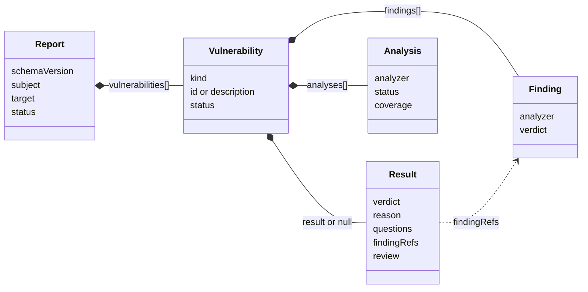
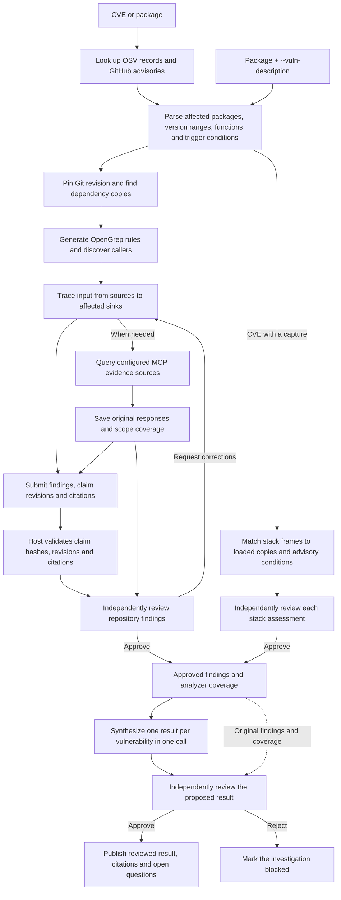

# Investigate vulnerability exploitability

Investigate whether a vulnerability in a dependency can affect your application. Run a check against a CVE or a package. For each vulnerability, the report gives one reviewed result, the findings behind it, and the questions that remain.

## Before you begin

Open a Git checkout with at least one commit and enable the experimental commands in your shell.

```sh
export CODEX_SECURITY_ENABLE_DEPENDENCY_EXPLOITABILITY=1
```

## Quickstart

Choose an investigation target and provide any evidence or constraints you already have.

```sh
# Investigate a CVE
cs exploitability check CVE-2019-10744

# Check a package against its published advisories
cs exploitability check npm:lodash
cs exploitability check PyPI:Pillow

# Investigate an unpublished vulnerability
cs exploitability check npm:example-parser --vuln-description "decode may accept a declared length larger than the input in 1.x"

# Trace a specific source to an affected operation
cs exploitability check CVE-2019-10744 --sources handle --sinks defaultsDeep

# Include captured runtime stacks from a file or directory
cs exploitability check CVE-2019-10744 --analyzer-input stacks=./capture

# Connect evidence sources and apply a project scope
cs exploitability check CVE-2019-10744 --config project.yaml

# Save a report for review
cs exploitability check CVE-2019-10744 --format md --report-file review.md
cs exploitability check CVE-2019-10744 --format html --report-file review.html
```

For an unpublished vulnerability, describe the suspected versions, affected operation, and triggering input. `--vuln-description` replaces public advisory lookup and labels the result **Supplied advisory**. Package checks and supplied descriptions investigate the repository. Use a CVE to assess runtime stacks.

A check prints a summary by default. [Read a Markdown report](#read-a-report) to see why the reviewer approved a result, [use JSON](#automate-checks) in a pipeline, or [drive the investigation with your own agent](#integrate-with-a-hosted-agent-platform).

## Set the scope and evidence sources

### Trace an input to a vulnerable function

A **source** is where input enters your code. A **sink** is the operation you want to check. To check an API handler and a worker against the same sink, repeat `--sources`.

```sh
cs exploitability check CVE-2019-10744 --sources handle --sources loadConfig --sinks defaultsDeep
```

Specify one function per flag. Repeat `--sinks` in the same way to check several operations. If you know only the sink, pass `--sinks defaultsDeep` and let the check look for callers. These names limit both analyzers for this run. Set them on the command line. Project files reject `exploitability.sources` and `exploitability.sinks`.

In the report, **Call path** shows how `handle` or `loadConfig` reaches `defaultsDeep`. **Sink call** identifies the call site. Check **Evidence** for the selected Lodash version and whether untrusted input reaches that operation.

### Connect evidence sources

Connect evidence sources when an investigation needs facts outside the repository, such as which revision is deployed, which packages an artifact contains, or whether an endpoint is reachable. You can connect service catalogs, artifact inventories, and telemetry systems through Model Context Protocol (MCP) servers.

Add each server to `codex.mcp_servers` in `project.yaml`, then reference it by name under `exploitability.evidence_sources`. Give each source instructions for the questions it should answer. Replace the example commands and tool names with your own.

```yaml
exploitability:
  scope:
    instructions: Assess the checkout API and checkout worker in services/checkout.
    exclude_paths:
      - services/checkout/fixtures
  evidence_sources:
    - server: service_catalog
      instructions: Identify running revisions and artifacts for the services in scope.
    - server: artifact_inventory
      instructions: Identify the packages and versions contained in each deployed artifact.
codex:
  mcp_servers:
    service_catalog:
      command: service-catalog-mcp
      enabled_tools: [get_deployment]
    artifact_inventory:
      command: artifact-inventory-mcp
      enabled_tools: [get_artifact_components]
```

Run the check with `--config project.yaml` or set `CODEX_SECURITY_PROJECT_CONFIG`. In the report, **Evidence** shows which external records support the finding. Missing evidence remains an open question.

<details>
<summary>Returning complete evidence</summary>

A response should say what scope was searched and whether the results are complete. An empty result can establish absence only for a complete search of that scope. If a required source is unavailable, the check may be blocked.

</details>

### Limit the search

Set `exploitability.scope.instructions` to describe the callers you want to check. This replaces the default scope of production services, jobs and workers. Use `exploitability.scope.exclude_paths` to skip checkout-relative paths in initial discovery and broad symbol searches. A targeted lookup or a nested `SECURITY.md` can still bring those paths into scope.

## Captured stacks

### Add a backtrace

If your worker runs a different build from the checkout, a profiler or debugger can show which function it called. Create a directory named `capture` and save this example as `capture/stacks.json`. List the active function first and its callers next. Here `loadConfig` called `defaultsDeep`.

```json
{
  "format": "codex-security.stacks/v2",
  "captures": [
    {
      "stacks": [
        { "frames": [{ "name": "defaultsDeep" }, { "name": "loadConfig" }] }
      ]
    }
  ]
}
```

Find **Captured stack** in the findings for this CVE. It shows the caller first and preserves the original frame numbers. A stack may come from a different build than the checkout. The function names alone cannot tell you which version ran or who supplied the input.

### Run only the stacks analyzer

With no analyzer settings, `check` investigates the repository and any supplied capture. To limit the check to stacks, save this as `stacks-only.yaml` beside the `capture` directory.

```yaml
exploitability:
  analyzers:
    stacks:
      input: ./capture
```

```sh
cs exploitability check CVE-2019-10744 --config stacks-only.yaml --format md
```

Add `repository: {}` alongside `stacks` to run both. The configured input is relative to the project file. To use a different directory for one run, append `--analyzer-input stacks=./other-capture`. That path resolves relative to your working directory. Without a capture, the CLI skips stacks. If that leaves no analyzer, the command asks for input.

### Identify the loaded copy

A frame named `defaultsDeep` does not identify its package. If the debugger resolved the loaded module path and manifest, replace the first frame (`{"name":"defaultsDeep"}`) in `capture/stacks.json` with this object. A list of installed packages cannot tell you which copy ran. In that case, leave `package` out.

```json
{
  "name": "defaultsDeep",
  "package": {
    "name": "lodash",
    "version": "4.17.21",
    "provenance": "loaded module path and package manifest"
  }
}
```

If you have more details, put `"origin":"debugger backtrace"` on the capture, `"labels":{"process":"worker"}` on the stack and `"location":"config.js","line":12` on the caller frame. Set `sourceRevision` on a frame only if you know which source commit produced it.

Next, tell the analyzer which versions of `defaultsDeep` the CVE affects. The `--sinks` flag selects a function by name. A catalog supplies the missing package and version range. Save this as `capture/sinks.json`.

```json
{
  "format": "codex-security.sinks/v2",
  "cve": "CVE-2019-10744",
  "sinks": [
    {
      "id": "lodash-defaults",
      "function": "defaultsDeep",
      "package": "lodash",
      "versionScheme": "semver",
      "affectedVersions": ["<4.17.12"],
      "preconditions": []
    }
  ]
}
```

Pass the capture directory so the CLI reads both files. In the report, read **Package evidence** and **Independent review** under **Evidence**. If the evidence ties frame 0 to Lodash 4.17.21, **Ruled out** applies to that call. Your API might still load a different copy.

<details>
<summary>When to supply sources.json or sinks.json</summary>

Put either catalog beside a capture file and pass the directory to `--analyzer-input stacks=PATH`. A catalog alone cannot start a stack check. `sources.json` (`codex-security.sources/v2`) lists entry points and accepts an empty list. `sinks.json` (`codex-security.sinks/v2`) names the requested CVE. If you supply `sinks`, list at least one affected operation. Your ranges take precedence over public advisory ranges.

Omit `sinks.json` to use structured advisory data. A function mentioned only in prose or a package name shared across ecosystems may leave the operation unresolved. `--sinks defaultsDeep` narrows the search but cannot supply the missing package or version range. Add a catalog for that detail. If you name functions with [`--sources` or `--sinks`](#trace-an-input-to-a-vulnerable-function) and supply a nonempty catalog for that flag, the names must match entries exactly. The selected entries keep their version ranges and other evidence. For all fields, see `@openai/codex-security/schemas/dependency-stack-inputs-v2.schema.json` in the installed package.

</details>

### Read multiple captures

| `--analyzer-input` value             | What the CLI reads                                                                                                                                  |
| ------------------------------------ | --------------------------------------------------------------------------------------------------------------------------------------------------- |
| `stacks=./profiles/debug.json`       | One capture file.                                                                                                                                   |
| `stacks=./capture`                   | Every `.json` file directly inside the directory. `sources.json` and `sinks.json` are optional catalogs. `manifest.json` selects a prepared replay. |
| `'stacks=./profiles/**/stacks.json'` | Matching capture files. Quote the pattern so the CLI expands it.                                                                                    |

Only directory inputs load catalogs. Keep unrelated JSON and reports outside the directory. The CLI reads distinct paths in sorted order and keeps identical traces from different files. It rejects symlinks, empty matches, malformed captures and v1 inputs.

For a prepared replay, select the directory containing `manifest.json`. The CLI verifies the saved inputs, caller scope, CVE and checkout revision. Omit `--sources` and `--sinks` to reuse the saved names. To change the names, start from the original captures.

<details>
<summary>Record a partial search and a search with no matches</summary>

Keep each query with its own results. An empty `stacks` array requires a query.

```json
{
  "format": "codex-security.stacks/v2",
  "captures": [
    {
      "query": {
        "selectors": { "function": "defaultsDeep", "service": "checkout-api" },
        "coverage": "partial"
      },
      "stacks": [
        { "frames": [{ "name": "defaultsDeep" }, { "name": "loadConfig" }] }
      ]
    },
    {
      "query": {
        "selectors": { "function": "defaultsDeep", "service": "worker" },
        "window": {
          "start": "2026-01-01T09:00:00Z",
          "end": "2026-01-01T09:05:00Z"
        },
        "coverage": "complete"
      },
      "stacks": []
    }
  ]
}
```

The first query found one call and may have missed others. The second found no matching sample in its time window. Neither result tells you how often the function ran. A complete search with no matches yields `no_match`. Partial or unknown coverage with no matches yields `no_coverage`. Both appear in the stacks analyzer’s `coverage.items`. Neither produces a finding or rules out a call outside that search. Other evidence can still support a result for the vulnerability.

</details>

## Read a report

Open `review.md` from the [quickstart](#quickstart) or pass `--format md` to print the report in your terminal. Read **Overall result** and **Open questions** first. Then follow the findings for each caller or recorded call. A package can have several vulnerabilities, each with its own result.

For example, the API can call an affected Lodash release while the worker loads a fixed release. A **Ruled out** finding for the worker leaves the API question open. The result explains how both findings affect the decision for this CVE.

HTML reports add filtering and expandable source excerpts. If you omit `--report-file` for HTML, the CLI creates a timestamped file in the working directory. Saved reports require a new filename.

For other integrations, `--format` accepts `json`, `jsonl`, `yaml`, and `toon`. A standalone `--report-file` writes JSON. The filename extension does not choose the format.

### Understand a finding

Check **Analyzed commit**. If the report lists several findings under **Results**, pick one caller and build. Here’s an illustrative excerpt for an API that uses Lodash.

```md
## `src/handler.ts:2` — Potentially exploitable

Checkout API · deployment configured · `lodash 4.17.11`

The checkout API calls defaultsDeep. The running build is unverified.

**What would decide this** — Which build runs in production?
```

The API selects an affected release and calls the affected function. Its configuration cannot tell you which build is live. **What would decide this** names the next check. Look under **Evidence** for the source lines and deployment records behind the verdict.

### Choose the next action

| Verdict                       | Action                                                                                                                             |
| ----------------------------- | ---------------------------------------------------------------------------------------------------------------------------------- |
| **Exploitable**               | Fix the call or upgrade the affected copy. Verify the running build includes the fix.                                              |
| **Potentially exploitable**   | Prioritize a fix. The caller uses an affected operation. Check the outstanding conditions, such as who can reach it in production. |
| **Ruled out**                 | Record which condition fails for this caller and build. Check the other copies separately.                                         |
| **Requires more information** | Follow **What would decide this**. For example, identify which version a worker loads before assessing its call.                   |

If the report shows zero reviewed uses, check what the search missed. Read **Unresolved candidate**, **Dismissed candidates** and **Report limitations** when present. A blocked check means the investigation or review could not finish. [Keep its partial results](#handle-a-blocked-check) and retry after resolving the blocker.

## Automate checks

Save the report as JSON, then read `vulnerabilities[]`. The same query works for a CVE, a package or a supplied description. It also works when you add stacks to a CVE investigation.

```sh
cs exploitability check CVE-2019-10744 --report-file findings.json
jq '.vulnerabilities[] |
    {vulnerability: (.id // .description), status, verdict: .result.verdict, questions: .result.questions}' findings.json
```

The CLI returns one result for each vulnerability it finishes investigating, even if the analyzers recorded no findings. A verdict of `unknown` comes with questions about the missing evidence. A `blocked` or `pending` vulnerability has `result: null`.

### Find results in JSON

The version 3 report separates the decision for a vulnerability from the calls and searches behind it. To validate a report, use `@openai/codex-security/schemas/exploitability-report.schema.json` from the installed package.



- `subject` identifies the CVE or package you asked to investigate. Each entry in `vulnerabilities` has either `kind: "advisory"` and an `id`, or `kind: "hypothesis"` and your `description`.
- `result` explains the decision and records its review. `findingRefs` contains zero-based indexes into the same vulnerability’s `findings`. A result can cite evidence from both analyzers.
- `findings` describes individual uses or observed stacks. Look at `analyzer` before reading the details. A repository finding identifies the caller (`location`), build (`place`) and decisive citations (`decidingEvidence`). A stack finding identifies the captured call with `workItemId`.
- `analyses` tells you which analyzers ran and what they covered. An enabled stacks analyzer without input is `skipped`. Empty stack searches appear in coverage as `no_match` or `no_coverage`. Repository coverage tracks unresolved and dismissed candidates, searches and limitations.

Follow the result’s references to list the specific calls behind it.

```sh
jq '.vulnerabilities[] as $v | $v.result.findingRefs[]? as $i |
    $v.findings[$i] |
    {vulnerability: ($v.id // $v.description), analyzer, verdict, call: (.location // .workItemId)}' findings.json
```

If a complete result returns no rows, it cites no findings. Inspect `analyses[].coverage` before drawing a conclusion from an empty search. JSON verdicts are `exploitable`, `potentially_exploitable`, `ruled_out` and `unknown`. Markdown displays `unknown` as **Requires more information**.

<details>
<summary>Trace a finding to its evidence</summary>

- Inspect a repository finding’s `proof` for advisory conditions and `trace` for the call path. A `gap` marks a missing link. Check `openConditions` and `inspections` for remaining work.
- Use `place` to identify the build or workload. `version` is the selected package release. A Git revision identifies the source commit. A claim revision identifies the draft a reviewer checked. Adding a citation can change that revision without changing the package or commit.
- Follow `decidingEvidence` to the reviewer’s citations. A `receiptId` identifies a saved response. A `selection` identifies a record inside it.
- A stack work item such as `captures/0/stacks/0` identifies the first captured call. Its `sourceFile` records the original filename and position. A query with no matches, such as `captures/1`, belongs to coverage.

</details>

### Handle a blocked check

A **blocked** check could not finish. It exits with code 2 and does not create a `--report-file`. To retain partial results, capture JSON stdout and preserve the original exit status.

```sh
RUN="$(mktemp -d)"
echo "Results directory: $RUN"
(
  status=0
  cs exploitability check npm:lodash --format json \
    --progress-events "$RUN/progress.jsonl" > "$RUN/report.json" || status=$?
  if [ "$status" -eq 2 ] && jq -e '.status == "blocked"' "$RUN/report.json" >/dev/null; then
    jq '{reason, unfinished: [.vulnerabilities[] | select(.status != "complete") |
      {vulnerability: (.id // .description), status, analyses: [.analyses[] | {analyzer, status, reason}]}]}' "$RUN/report.json"
  fi
  exit "$status"
)
```

Use `reason` to decide what to fix, then retry. The report retains completed findings. A `pending` entry has work that has not started, such as the final review. Other errors can also exit with code 2. If stdout contains no blocked report, check stderr.

Progress events can change during review. Use the final report for decisions. The `finished` event records completion, a block, a failure or interruption.

## Integrate with a hosted agent platform

Expose the `cs exploitability run` commands as tools to your agent. Your platform supplies the investigator and decides which command to call next. Commands return JSON by default. With the [OpenAI Agents API](https://developers.openai.com/api/docs/guides/agents-api/overview), give the agent a sandbox with the CLI, Git checkout, and persistent investigation state file so it can invoke these commands.

| Command                                          | Input                                                                                                          | Result                                                                                           |
| ------------------------------------------------ | -------------------------------------------------------------------------------------------------------------- | ------------------------------------------------------------------------------------------------ |
| `init --repo REPO --state STATE`                 | Optional investigation metadata through `--json-stdin`, or a prepared input directory through `--inputs PATH`. | Creates or reopens an investigation pinned to the checkout and commit.                           |
| `tools --state STATE`                            | None.                                                                                                          | Lists every operation and its JSON input schema.                                                 |
| `record-evidence --state STATE --json-stdin`     | Source ranges or an original runtime result, supplied as JSON or a file with its digest.                       | Saves the evidence and returns its reference.                                                    |
| `record-observations --state STATE --json-stdin` | A v2 stack capture or a saved runtime receipt ID.                                                              | Imports observations and returns work item IDs.                                                  |
| `next --state STATE`                             | None.                                                                                                          | Returns the current outstanding work item, original frames, capture receipt, and open questions. |
| `record-claims --state STATE --json-stdin`       | Scoped claims with citations, receipt selections, or dependencies on other claims.                             | Returns the saved claim revision references.                                                     |
| `query-claims --state STATE --json-stdin`        | Claim IDs or a scope and payload search.                                                                       | Returns current claim revisions and their states.                                                |
| `record-assessments --state STATE --json-stdin`  | A verdict, supporting claim references, and any missing evidence for the item returned by `next`.              | Saves the assessment for that item.                                                              |
| `summarize-coverage --state STATE`               | None.                                                                                                          | Lists completed work, outstanding items, and coverage gaps.                                      |
| `finalize --state STATE`                         | Optional `--format md --report-file review.md` or another report format.                                       | Rechecks the assessments and returns the immutable report.                                       |

Prefix every command above with `cs exploitability run`. Call `init` before `tools` or any other operation. For mutation retries, include the same `operationId` in the same JSON request to recover the previous result. Keep the checkout at the pinned commit and reuse the state file to resume.

These commands perform an investigation driven by your platform. They do not invoke a model or provide independent review. In the [JSON report](#find-results-in-json), `vulnerabilities[].result.review.status` is `not_reviewed` for a manual investigation. Use `cs exploitability check` for a check with independent review.

## How a CVE check works

A CVE investigation has two review stages. First, each analyzer submits findings for the calls it investigated. Then the CLI combines the approved findings and the limits of each search into one proposed result. A separate reviewer decides whether the evidence supports that result.



### Resolve the advisory

For a CVE, the CLI looks up OSV records and associated GitHub advisories. For a package, it investigates each published advisory in turn. With `--vuln-description`, it works from the supplied hypothesis and skips public advisory lookup. It preserves the affected package coordinates, explicit versions, and ordered range events such as `introduced` and `fixed`. Structured function names help identify candidate operations. The investigator also reads the advisory text to identify the conditions needed to trigger the vulnerability.

A matching name or version identifies a candidate. The investigator still needs to connect the called function to the dependency copy your application loads.

### Discover copies and callers

The repository investigation pins a Git commit and reads manifests, lockfiles, imports, build definitions, and source files. It distinguishes separate dependency copies, including a wrapper and a native library with independent versions.

The CLI generates initial OpenGrep rules from the known operation names and local imports. Their matches identify possible callers. The investigator can use the code trace tool with more specific rules, inspect the matched code, and follow arguments from a source to a sink. The investigation tracks which candidate files have been examined and which paths remain open. If OpenGrep is unavailable or only scans part of the code, the report records the limitation.

With `--analyzer-input stacks=PATH`, the stack analyzer also assesses captured calls against the advisory. A matching frame name identifies a lead. Ruling out an affected version requires evidence identifying the copy that supplied the frame. A separate stack reviewer checks each assessment against its capture, package evidence and supporting claims. Queries with no matching frames contribute to search coverage.

### Collect evidence for the deployed system

Source code can establish that a caller selects a dependency and passes input to an affected operation. It cannot, by itself, establish that the selected build is running or that a particular caller can reach it.

The repository investigator queries [configured evidence sources](#set-the-scope-and-evidence-sources) when it needs those facts. For example, it can ask a service inventory for the deployed revision, an artifact inventory for the dependency copy in that build, or a telemetry service for observed access. The CLI records the original tool responses, follows linked records from the same server, and associates claims with precise citations. A partial response can support an observed match. Before using an empty result to establish absence, the investigator must establish that the source covered the requested search. The SDK can request a separate model judgment to interpret an unfamiliar coverage declaration.

If the evidence is missing, the finding retains the open question. A required source that cannot provide the requested scope can block the investigation. The report distinguishes an incomplete investigation from an individual use whose verdict requires more information.

### Submit claims and review findings

A claim states a fact and cites the source lines, recorded tool responses, or previously approved claims that support it. Investigators can reuse an approved claim across findings without treating an uncited summary as evidence. Each submitted claim has a fixed revision and content hash. The host checks both when a finding cites that claim. Editing the claim creates a new revision that must pass review before the finding can rely on it.

The host checks the submitted finding and its citations before sending it to an independent reviewer. The reviewer checks the selected version, call path, advisory conditions, deployment facts and unanswered questions against the original evidence. It selects the citations that decided the finding. It can reject a submission and request corrections. The investigator can revise and resubmit it for review.

A repository finding’s **Deciding evidence** can include source citations, original responses and evidence from approved supporting claims. Stack findings cite the captured calls and the claims their assessments rely on.

### Review the result for each vulnerability

After the analyzers finish, the CLI makes one model call per vulnerability to synthesize the result. The model considers approved findings alongside search coverage, including unresolved candidates and gaps. It proposes a verdict, cites the findings behind it and lists open questions. It can connect two findings only when the evidence shows they concern the same dependency copy and scope. For example, a fixed copy in the worker cannot rule out an affected copy in the API.

A second, independent model call checks that proposal against the original findings and coverage. Approval publishes the reviewed result. A rejected or invalid proposal blocks the investigation without a correction round. The report retains completed work and explains [what blocked the result](#handle-a-blocked-check).

## Security and limitations

A reviewed check reads the checkout and can share source excerpts, tool replies and linked records with the configured model provider. Grant tools only the read permissions they need. A stack check also writes to a temporary directory.

The CLI sends advisory identifiers to OSV and GitHub. It does not send stack frames to those services. Requests for GitHub source include a repository, commit and path. They omit credentials and reject redirects.
