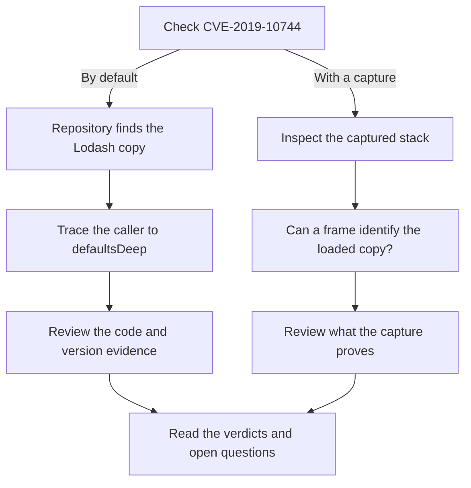

# Check whether a vulnerability affects your code

Start with a vulnerability ID such as `CVE-2019-10744` or [a package name](#check-a-package) such as `npm:lodash`. You can run the check without a scanner.

If Dependabot flags `lodash@4.17.11` for this CVE, that **dependency alert** tells you the version matches a known vulnerability. You still need to check whether your code calls the affected function, `defaultsDeep`, in a build you deploy.

Run `cs exploitability check CVE-2019-10744` in a Git checkout. By default, the **repository analyzer** reads your code and lockfiles to find which version each caller uses and how it calls the function. If you supply a backtrace or profile, the **stacks analyzer** also checks the calls you recorded. Each analyzer reports its own findings.

- [Check a CVE](#quickstart) and read the verdict for one caller.
- [See how the check works](#how-a-cve-check-works) with a Lodash example.
- [Confirm what shipped](#set-the-scope-and-evidence-sources) or [add a captured stack](#captured-stacks).
- [Automate checks](#automate-checks), [try an offline run](#try-a-local-run) or [browse the source](#follow-the-code).

## Before you begin

Install the [Codex Security CLI](../README.md#install). Open a Git checkout with at least one commit. Enable the experimental commands in your shell and confirm that `check --help` lists `--analyzer-input`.

```sh
export CODEX_SECURITY_ENABLE_DEPENDENCY_EXPLOITABILITY=1
cs exploitability check --help
```

For `check`, [sign in or configure a model provider](cli.md#authentication). The CLI looks up public advisories with OSV and GitHub. It sends relevant source excerpts and evidence to your model provider. To try the tool without credentials or network access, [run a manual investigation](#try-a-local-run).

<details>
<summary>Use a custom model provider</summary>

Select the investigator with `--model` and `--effort`. Define custom providers in the top-level `model_providers` table and set `env_key` to your credential variable’s name. A profile can select a provider by name. Reviewed checks reject provider definitions inside profiles and custom base URLs for the built-in OpenAI provider.

</details>

## Quickstart

### 1. Save a Markdown report

Run the example as written or substitute the CVE you want to investigate.

```sh
cs exploitability check CVE-2019-10744 --format md --report-file review.md
cat review.md
```

The CLI prints a summary and the path to `review.md`. Choose a new filename each time because the CLI refuses to overwrite a report. Omit `--report-file review.md` to print the full Markdown in your terminal, or run `cs exploitability check CVE-2019-10744` for just the summary.

### 2. Read one finding

Check **Analyzed commit**. If the report lists several findings under **Results**, pick one caller and build. Here’s an illustrative excerpt for an API that uses Lodash.

```md
## `src/handler.ts:2` — Potentially exploitable

Checkout API · deployment configured · `lodash 4.17.11`

The checkout API calls defaultsDeep. The running build is unverified.

**What would decide this** — Which build runs in production?
```

The API selects an affected release and calls the affected function. Its configuration cannot tell you which build is live. **What would decide this** names the next check. Look under **Evidence** for the source lines and deployment records behind the verdict.

### 3. Decide what to do next

| Verdict                       | Action                                                                                                                             |
| ----------------------------- | ---------------------------------------------------------------------------------------------------------------------------------- |
| **Exploitable**               | Fix the call or upgrade the affected copy. Verify the running build includes the fix.                                              |
| **Potentially exploitable**   | Prioritize a fix. The caller uses an affected operation. Check the outstanding conditions, such as who can reach it in production. |
| **Ruled out**                 | Record which condition fails for this caller and build. Check the other copies separately.                                         |
| **Requires more information** | Follow **What would decide this**. For example, identify which version a worker loads before assessing its call.                   |

If the report shows zero reviewed uses, check what the search missed. Read **Unresolved candidate**, **Dismissed candidates** and **Report limitations** when present. A blocked check means the investigation or review could not finish. [Keep its partial results](#handle-a-blocked-check) and retry after resolving the blocker.

## How a CVE check works

The [advisory for CVE-2019-10744](https://osv.dev/vulnerability/GHSA-jf85-cpcp-j695) describes prototype pollution in `defaultsDeep`. It affects the npm package `lodash` before 4.17.12. Consider an example checkout API and a background worker.



**Check the API.** Suppose the API’s lockfile selects Lodash 4.17.11. Its request handler in `src/handler.ts` passes options to the affected function.

```ts
import _ from "lodash";
export const handle = (options: object) => _.defaultsDeep({}, options);
```

The reviewer checks that the handler selects that copy and that the source supports the reported call. With the running build still unknown, the reviewer can approve **Potentially exploitable**. To confirm exposure, identify the build running in production and verify who controls `options` and which keys they can set.

**Check the worker.** A backtrace shows `loadConfig` calling `defaultsDeep`. The function name alone leaves the library version open. If a debugger ties that frame to Lodash 4.17.21, a reviewer can approve **Ruled out** for the captured call. That version falls outside the affected range. The API still needs its own deployment evidence.

When both analyzers run with default settings, the repository runs first. Read the **Repository analyzer** and **Stacks analyzer** sections separately. Each has its own reviewed findings.

## Check a package

If you have a package name instead of a CVE, specify its ecosystem. The CLI finds the public advisories and reports on each one separately.

```sh
cs exploitability check npm:lodash --format md --report-file lodash.md
cs exploitability check PyPI:Pillow --format md --report-file pillow.md
```

For a suspected issue without a public advisory, describe the condition you want to check. The CLI skips advisory lookup and labels the result **Supplied advisory**.

```sh
cs exploitability check npm:example-parser \
  --vuln-description "Suspected failure to validate the declared input length." \
  --format md --report-file hypothesis.md
```

To include captured stacks, run the check for one CVE. For a package or description, omit the stack input.

## Set the scope and evidence sources

### Confirm which build is running

A lockfile tells you which version a build selects. To connect that build to production, give the check read-only access to a deployment inventory. Replace the service and tool names in this example with your own. Save it as `project.yaml`.

```yaml
exploitability:
  scope:
    instructions: Assess the checkout API and checkout worker in services/checkout.
    exclude_paths:
      - services/checkout/fixtures
  evidence_sources:
    - server: service_catalog
      instructions: >-
        Find the production deployment for checkout-api and checkout-worker.
        Match the running revision and artifact to the dependency copy recorded
        in the artifact inventory. Report missing inventory data as unknown.
codex:
  mcp_servers:
    service_catalog:
      command: service-catalog-mcp
      enabled_tools: [get_service, get_deployment, get_artifact_components]
```

```sh
cs exploitability check CVE-2019-10744 --config project.yaml --format md
```

In the report, match the deployed revision or artifact to the caller and dependency copy. If a request passes from the API to a worker, the API’s lockfile covers only the API. Look for the worker’s own artifact or runtime inventory.

Select the project file with `--config` or `CODEX_SECURITY_PROJECT_CONFIG`. The CLI does not load `project.yaml` automatically.

### Limit the search

- Set `exploitability.scope.instructions` to replace the default scope of production services, jobs and workers. Check **Scope** before applying a verdict.
- Use `exclude_paths` to skip checkout-relative paths in initial discovery and broad symbol searches. Package searches, exact file requests and nested `SECURITY.md` files can still bring them into scope.
- If you know every relevant entry point or affected operation, set `exploitability.sources` or `exploitability.sinks`. Omit a list to allow discovery. `sources: []` declares no entry points. A supplied `sinks` list must contain at least one operation.

<details>
<summary>How to interpret a catalog reply</summary>

A partial list can confirm a service exists. An empty list alone cannot rule one out. Check whether the cited coverage statement covers the query and every page. The CLI [verifies the quoted value](../src/exploitability/graph-evidence.ts). A model interprets its meaning. Oversized replies, resource links or an unavailable model can leave coverage open. Coverage and bundled-library checks can each add a model request that includes the current thread history.

If you run the catalog, report outages for the exact scope requested. For `{"scope":"production"}`, a reply of `{"structuredContent":{"coverage":{"scope":"production","available":false}}}` can block that check. A message or incomplete page alone cannot. When a complete lookup finds no artifact, return `{"structuredContent":{"artifact":null,"coverage":{"complete":true}}}`. Multiple distinct failed or missing lookups can block a check, as can a required server failing to start.

</details>

### Request Daybreak (optional)

To request Daybreak on a repository check, use the OpenAI provider and run the following command.

```sh
cs exploitability check CVE-2019-10744 --codex daybreak=true --format md
```

Look for `daybreak_blue` or `daybreak_red` in the **Turn access program** progress message. If it says `unconfirmed` or no program appears, check your [account and model access](cli.md#daybreak-opt-in) before relying on Daybreak. To reuse the setting, set `codex.daybreak: true` in your project file.

## Captured stacks

### Add a backtrace

Create a directory named `capture` and save the following as `capture/stacks.json`. List frames from the active function to its callers. Here `loadConfig` called `defaultsDeep`.

```json
{
  "format": "codex-security.stacks/v2",
  "captures": [
    {
      "stacks": [
        { "frames": [{ "name": "defaultsDeep" }, { "name": "loadConfig" }] }
      ]
    }
  ]
}
```

```sh
cs exploitability check CVE-2019-10744 --analyzer-input stacks=./capture --format md
```

Read **Captured stack** in the **Stacks analyzer** section. It shows the caller first and preserves the original frame numbers. A stack may come from a different build than the checkout. The function names alone cannot tell you which version ran or who supplied the input.

### Identify the loaded copy

If a debugger can identify the library for a specific frame, add its name, version and how you identified it. Replace `capture/stacks.json` with this example. Omit `package` when you only have a list of installed packages.

```json
{
  "format": "codex-security.stacks/v2",
  "captures": [
    {
      "origin": "debugger backtrace",
      "stacks": [
        {
          "labels": { "process": "worker" },
          "frames": [
            {
              "name": "defaultsDeep",
              "package": {
                "name": "lodash",
                "version": "4.17.21",
                "provenance": "loaded module path and package manifest"
              }
            },
            { "name": "loadConfig", "location": "config.js", "line": 12 }
          ]
        }
      ]
    }
  ]
}
```

Tell the analyzer which operation and versions the advisory covers. Save the Lodash entry as `capture/sinks.json`.

```json
{
  "format": "codex-security.sinks/v2",
  "cve": "CVE-2019-10744",
  "sinks": [
    {
      "id": "lodash-defaults",
      "function": "defaultsDeep",
      "package": "lodash",
      "versionScheme": "semver",
      "affectedVersions": ["<4.17.12"],
      "preconditions": []
    }
  ]
}
```

Run the same check again. If the evidence ties frame 0 to Lodash 4.17.21, **Ruled out** applies to this call. Look under **Evidence** for **Package evidence** and **Independent review**. Use `sourceRevision` on a frame only if you know which source commit produced that code.

<details>
<summary>When to supply sources.json or sinks.json</summary>

Put either catalog beside a capture file and pass the directory to `--analyzer-input stacks=PATH`. A catalog alone cannot start a stack check. `sources.json` (`codex-security.sources/v2`) lists entry points and accepts an empty list. `sinks.json` (`codex-security.sinks/v2`) names the requested CVE. If you supply `sinks`, list at least one affected operation. Your ranges take precedence over public advisory ranges.

Omit `sinks` to use structured advisory data. A function mentioned only in prose or a package name shared across ecosystems may leave the operation unresolved. Supply a catalog when the function or version range is missing. See the [v2 input schema](../schemas/dependency-stack-inputs-v2.schema.json).

</details>

### Read multiple captures

| `--analyzer-input` value             | What the CLI reads                                                                                                                                  |
| ------------------------------------ | --------------------------------------------------------------------------------------------------------------------------------------------------- |
| `stacks=./profiles/debug.json`       | One capture file.                                                                                                                                   |
| `stacks=./capture`                   | Every `.json` file directly inside the directory. `sources.json` and `sinks.json` are optional catalogs. `manifest.json` selects a prepared replay. |
| `'stacks=./profiles/**/stacks.json'` | Matching capture files. Quote the pattern so the CLI expands it.                                                                                    |

Only directory inputs load catalogs. Keep unrelated JSON and reports outside the directory. The CLI reads distinct paths in sorted order and keeps identical traces from different files. It rejects symlinks, empty matches, malformed captures and v1 inputs.

For a prepared replay, select the directory containing `manifest.json`. The CLI verifies the saved inputs, caller scope, CVE and checkout revision.

<details>
<summary>Record a partial search and a search with no matches</summary>

Keep each query with its own results. An empty `stacks` array requires a query.

```json
{
  "format": "codex-security.stacks/v2",
  "captures": [
    {
      "query": {
        "selectors": { "function": "defaultsDeep", "service": "checkout-api" },
        "coverage": "partial"
      },
      "stacks": [
        { "frames": [{ "name": "defaultsDeep" }, { "name": "loadConfig" }] }
      ]
    },
    {
      "query": {
        "selectors": { "function": "defaultsDeep", "service": "worker" },
        "window": {
          "start": "2026-01-01T09:00:00Z",
          "end": "2026-01-01T09:05:00Z"
        },
        "coverage": "complete"
      },
      "stacks": []
    }
  ]
}
```

The first query found one call and may have missed others. The second found no matching sample in its time window. Neither result tells you how often the function ran. A complete search with no matches yields `no_match`. Partial or unknown coverage with no matches yields `no_coverage`. Both leave the verdict at **Requires more information**.

</details>

### Run only the stacks analyzer

With no analyzer settings, `check` investigates the repository and any supplied capture. To limit the check to stacks, list only `stacks` in your project file.

```yaml
exploitability:
  analyzers:
    stacks:
      input: ./capture
```

```sh
cs exploitability check CVE-2019-10744 --config project.yaml --format md
cs exploitability check CVE-2019-10744 --config project.yaml --analyzer-input stacks=./other-capture --format md
```

Add `repository: {}` alongside `stacks` to run both. The configured input is relative to the project file. A command-line input overrides it for that run and resolves relative to your working directory. Without a capture, the CLI skips stacks. If that leaves no analyzer, the command asks for input.

## Save and share reports

Use `--format md --report-file review.md` for Markdown. To browse call sites, filter findings by verdict or expand source excerpts, save an HTML report.

```sh
cs exploitability check CVE-2019-10744 --format html --report-file review.html
```

Open the path the CLI prints. Without `--report-file`, HTML uses a timestamped file in the working directory. Review reports for source excerpts and sensitive evidence before sharing.

## Automate checks

Use `--report-file findings.json` to save JSON and keep the terminal summary. To save a different format, pass `--format` explicitly. Choose `md`, `html`, `json`, `jsonl`, `yaml` or `toon`. The filename extension has no effect. With JSON, `--filter-output` filters stdout only. The saved file still contains the full report.

```sh
cs exploitability check CVE-2019-10744 --report-file findings.json
jq '.uses[] | {location, component, version, verdict, decidingEvidence}' findings.json
```

| Check                             | Where to read the results                                                              |
| --------------------------------- | -------------------------------------------------------------------------------------- |
| One CVE in a repository           | `uses[]`                                                                               |
| A package or supplied description | `checks[]`, then `uses[]` per advisory. A supplied description has `advisoryId: null`. |
| Stacks only                       | `assessments[]`                                                                        |
| Repository and stacks             | `analyzers.repository.uses[]` and `analyzers.stacks.assessments[]`                     |

The verdicts are `exploitable`, `potentially_exploitable`, `ruled_out` and `unknown`. The report displays `unknown` as **Requires more information**.

<details>
<summary>Trace a verdict to its evidence</summary>

- Inspect `proof` for the operation and advisory conditions, then `trace` for the call path. A `gap` marks a missing link. Check `openConditions` and `inspections` for remaining work.
- Use `place` to identify the build or workload. `version` is the selected package release. The Git revision identifies the source commit. A claim revision identifies the draft a reviewer checked. Adding a citation can change that revision without changing the package or commit.
- Follow `decidingEvidence` to the reviewer's citations. A `receiptId` identifies a saved response. A `selection` identifies a particular record inside it. Check `coverage`, `searches` and `limitations` for unresolved or dismissed candidates.
- A stack assessment identifies a work item, such as `captures/0/stacks/0` for the first stack and `captures/1` for the second query with no matches. Check `sourceFile` for the original filename and capture position. See the [stack report schema](../schemas/stack-investigation-report-v2.schema.json).

</details>

### Handle a blocked check

A blocked investigation exits with code 2 and does not create a `--report-file`. If you need partial results, capture stdout even on failure.

```sh
status=0
cs exploitability check npm:lodash --format json --progress-events progress.jsonl > report.json || status=$?
echo "Exit code: $status"
```

For `status: "blocked"`, read `reason` and any completed results. `pendingAnalyzers` or `pendingAdvisories` lists work that never started. Other errors can also exit with code 2. Check stderr if stdout contains no blocked report.

Progress events can change during review. Use the final report for decisions. The `finished` event records completion, a block, a failure or interruption.

## Try a local run

To inspect a stack without a model or credentials, use `cs exploitability run`. You supply the assessment. These commands use a temporary SQLite file and do not fetch advisories. In a Git checkout, [enable the experimental command](#before-you-begin) and run this POSIX shell example.

```sh
RUN="$(mktemp -d)"
STATE="$RUN/investigation.sqlite"
cs exploitability run init --repo "$PWD" --state "$STATE" --json-stdin <<'JSON'
{"cve":"CVE-2019-10744"}
JSON
cs exploitability run record-observations --state "$STATE" --json-stdin <<'JSON'
{"format":"codex-security.stacks/v2","captures":[{"stacks":[{"frames":[{"name":"defaultsDeep"},{"name":"loadConfig"}]}]}]}
JSON
cs exploitability run next --state "$STATE"
```

`next` returns `captures/0/stacks/0`. Frame 0 names `defaultsDeep` but gives no package version. Record the missing evidence and finish the run in the same shell.

```sh
cs exploitability run record-assessments --state "$STATE" --json-stdin <<'JSON'
{"items":[{"workItemId":"captures/0/stacks/0","verdict":"unknown","supportingClaims":[],"reason":"The frame names do not identify the loaded library.","remainingQuestions":["Which library and version supplied defaultsDeep?"]}]}
JSON
cs exploitability run summarize-coverage --state "$STATE"
cs exploitability run finalize --state "$STATE" --format md --report-file "$RUN/review.md"
cat "$RUN/review.md"
```

Look for **Requires more information**, **Finalized offline** and `1/1 work items assessed`. For an independent review, submit the capture to `check`.

## Integrate with a hosted agent platform

Run each command on a worker with access to the checkout and the same SQLite file. `cs exploitability run tools --state "$STATE"` lists the operation schemas. For a prepared replay, pass the existing directory to `init --inputs`.

<details>
<summary>Save a runtime result and cite it in an assessment</summary>

Use `record-evidence` to save source ranges or an original runtime result. For a file, supply its path and SHA-256 digest.

```json
{
  "kind": "runtime",
  "server": "example-runtime",
  "tool": "profile.lookup",
  "arguments": { "service": "example" },
  "resource": { "path": "/path/to/result.json", "sha256": "<original SHA-256>" }
}
```

Pass `{"receiptId":"<returned receipt ID>"}` to `record-observations` to import that exact result. The CLI retains the parsed value and verified digest. Keep the original file for a byte-level audit. Use distinct `operationId` values to record otherwise identical imports as separate events.

Use `record-claims` to save cited facts, then `query-claims` to get their revision references. To rule out a version, cite the package on each relevant frame. The first frame’s package is at `["stack","frames",0,"package"]`. Submit each decision with `record-assessments`, then call `finalize` when no work remains. Manual reports have `review: null`.

Graph providers can supply `codex-security-graph-evidence/v1` through a receipt. The CLI reverses root-first frames into leaf-first order. An empty graph result counts as `no_match` only for complete, untruncated results with `empty_matches` and no pending page.

</details>

## Security and limitations

The investigator reads the checkout. A stack check also writes to a temporary directory. Grant connected tools only the read permissions needed for this check. Review what they return, including linked records, before sending evidence to the configured model provider.

The CLI sends advisory identifiers to OSV and GitHub. It does not send stack frames to those services. Requests for GitHub source include a repository, commit and path. They omit credentials and reject redirects. A matching content hash cannot establish that a search was complete or a build is running.

## Follow the code

These links point to the source tree on GitHub.

- [CLI selection](../src/exploitability/cli.ts) decides which analyzers have input and how to write the report.
- [Repository discovery](../src/exploitability/analyzers/repository/discovery.ts) generates OpenGrep rules from operation names and imports, when available, and searches committed files. During [call tracing](../../../plugins/codex-security/mcp-app/src/dependency-trace/provider.ts), the investigator can supply its own rules against the working tree. [Candidate binding](../src/exploitability/analyzers/repository/graph-candidates.ts) skips dirty files. Use a clean checkout to keep those views aligned.
- [Repository review](../src/exploitability/analyzers/repository/check.ts) checks [claims and citations](../src/exploitability/analyzers/repository/claims.ts). A new draft must pass review before replacing an approved finding.
- [Stack preparation](../src/exploitability/analyzers/stacks/packet.ts) turns captures into work items. [Assessment](../src/exploitability/analyzers/stacks/assessment.ts) checks what the frames support. [Review](../src/exploitability/analyzers/stacks/launcher.ts) checks the draft in `check`. The [offline commands](../src/exploitability/analyzers/stacks/run.ts) leave the decision to you.
